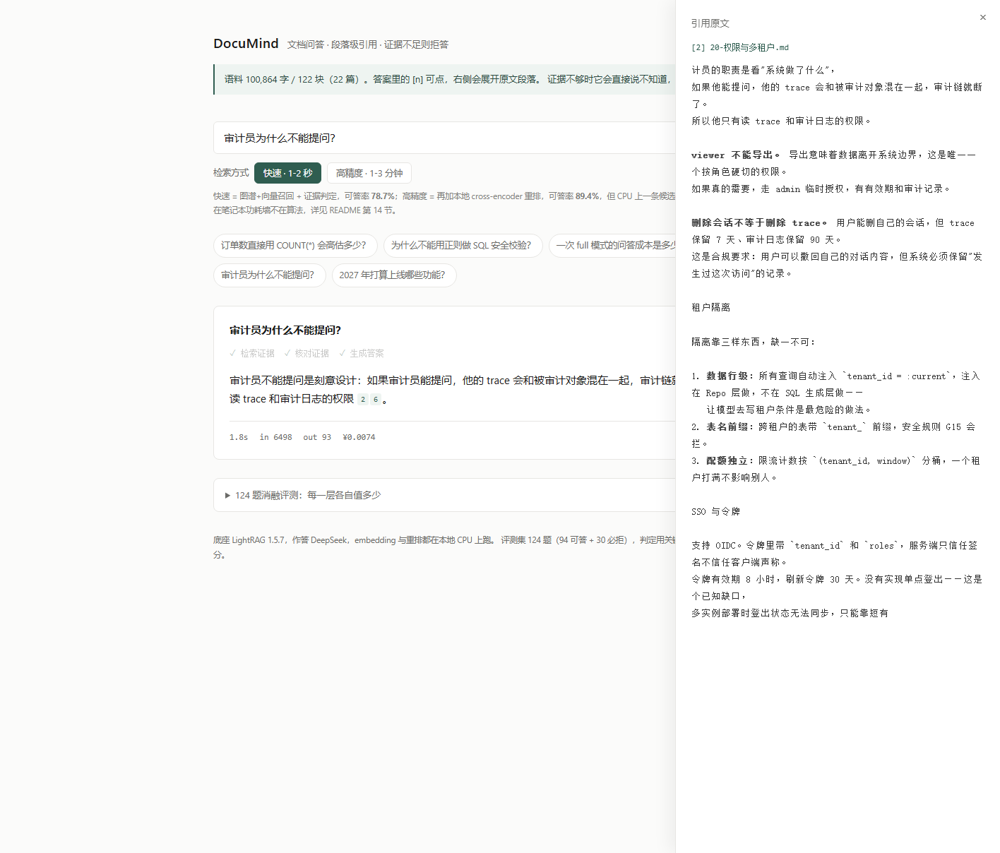
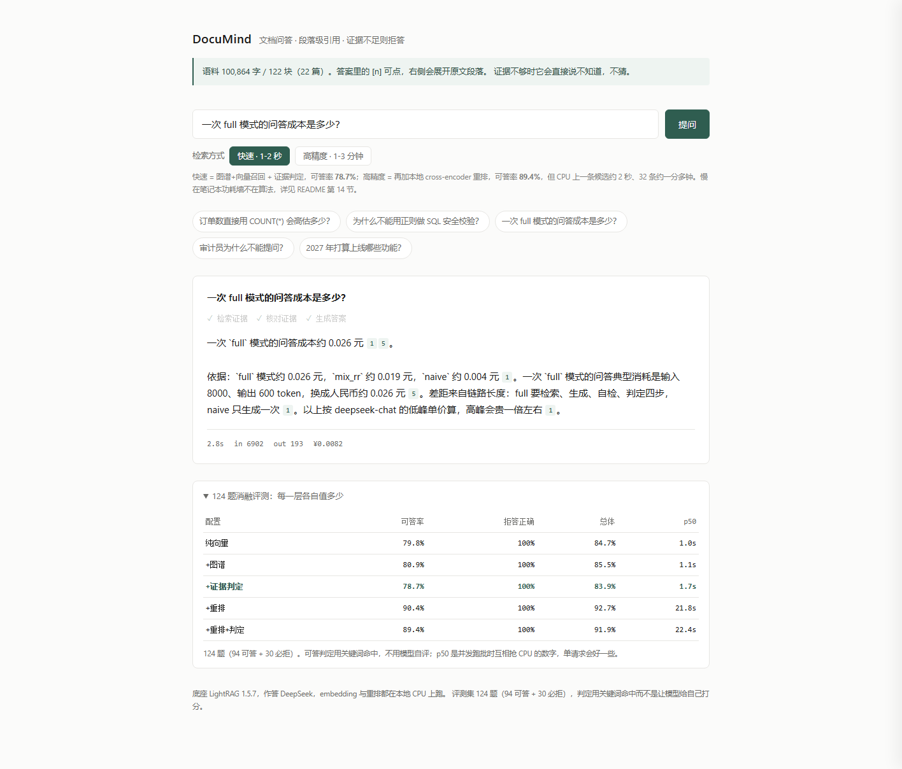

# DocuMind

基于 LightRAG 二次开发的文档问答系统：**段落级引用、证据不足拒答、全链路成本可计量**。
在 100,842 字 / 122 块的中文技术文档上，用 **316 道金标题（256 可答 + 60 必拒）**做消融，
验证图谱召回 / 重排 / 证据判定各自贡献多少；另带多轮对话、增量索引、多租户配额、
扫描件 OCR、SSE 流式问答、可点开原文的单页 UI、PDF 版面解析和 Docker 部署。

> **一句话说清"90%"**：重排组在 **124 题**上跑了 3 次，可答率 **88.3% – 95.7%**（极差 7.4pp），
> 旧版写的 90.4% 是其中一次抽样。所以准确说法是"重排带来 6–15pp 的提升"，
> 不是"准确率 90%"。扩到 316 题后同一套系统是 66.8%——掉的原因不是金标错
> （归因：0 道题的金标字符串不在语料里），而是新增题大量属于"答案只在一两个块里"的查表题，
> 6 块召回预算覆盖不到。误差棒见 2.1.1，归因见 2.2。

> **二次开发声明**：底座是 [HKUDS/LightRAG](https://github.com/HKUDS/LightRAG)（MIT），
> 以 pip 依赖方式使用（`lightrag-hku==1.5.7`），**未复制、未修改其源码**；
> 所有改动都在本仓库自有模块里，通过公开参数与注入点（`llm_model_func` / `embedding_func` /
> `rerank_model_func` / `chunking_func`）生效。第 5 节列明"上游有什么 / 我加了什么 / 我否掉了什么"。

---

## 1. 为什么做这个

三个问题，都是直接跑 `rag.aquery()` 解决不了的：

| 问题 | 直接调 `aquery()` | 本项目的做法 |
|---|---|---|
| 答案里的 `[1]` 指不到具体段落 | 引用是"参考了哪几个实体"，无法回溯 | 先只取证据（`aquery_data`）拿到结构化 chunk，自己编号再拼提示词，引用编号 = chunk 序号 |
| 文档里没有的问题也会硬答 | 没有拒答机制 | 加一跳"证据充分性判定"，判不足直接拒答，不让模型在空白处编 |
| 花了多少钱不知道 | 只返回字符串，无 usage | 自己封装 LLM 调用，累加真实 `prompt/completion_tokens`，成本是账单数字不是估算 |

---

## 2. 实测结果

语料是 22 篇中文技术文档（`seed/`：1 篇原始项目文档 + 21 篇由真值源生成，合计 100,842 字（实测值，见下注），切成 122 块）。

两套金标，分开报：

| 题集 | 题量 | 可答 | 必拒 | 用在哪 |
|---|---|---|---|---|
| `eval_set_v2.json` | 124 | 94 | 30 | **主结果**（2.1 节）。五组消融都跑在这一套上 |
| `eval_set_v3.json` | 316 | 256 | 60 | 扩题验证（2.2 节）。v2 的 124 题原样保留，其后追加 192 道从真值源生成的题 |

两套都是 `must_include` 字符串命中判定，**不用 LLM 当裁判**，避免自评偏差：
组间是 AND、组内是 OR，且每一条关键词都由 `tools/gen_gold3.py` 校验过
"逐字出现在语料原文里"——写不出这种字符串的题会被直接丢掉，不进金标。

题量从 40 扩到 124 的直接原因是：40 题里 30 道可答，**1 题 = 3.3pp**，
"90% vs 86.7%"其实只差一道题，这个粒度撑不住任何结论。124 题后 1 题 = 1.06pp，
最小的可观测差异从 3.3pp 降到 1pp 量级。

> **字数口径**：这里统一用 **100,842**，即索引里 `doc_status.content_length` 的累加，
> 也就是"真正进了索引的字符数"。按文件原样统计是 100,864，差 22——正好是 22 篇文档
> 各被去掉的一个行尾换行。两个数都对，含义不同；之前两张表各用了一个，
> 差 22 字看起来像笔误，所以统一成一个并在这里说清楚。
>
> 另有 `chunk_chars = 114,523`（切出来的块原文累加），比 100,842 大是因为块与块之间有
> 80 token 的重叠。`/readyz` 把两个数都返回，就是为了不用猜这个差额是从哪来的。

### 2.1 主结果：100,842 字 / 122 块 / 124 题

这一版把五组重测了一遍，**冷启动与热缓存分开报**。旧表（单栏成本）作废，
原因见本节末尾的「为什么旧成本列必须换掉」。

冷启动 = `LLM_CACHE=0`，每次提问都重新做关键词抽取；热缓存 = 抽取结果复用。
两者是同一个系统的两种真实使用场景，混在一张表里就不可比。

**冷启动口径**（每次提问都完整走一遍链路，相当于"第一次被问到的问题"）

| 配置 | 可答准确率 | 拒答 | 总体 | 调用/题 | tok/题 | 单题成本 |
|---|---|---|---|---|---|---|
| naive（只向量召回） | 81.9%（77/94） | 100%（30/30） | 86.3% | 1.00 | 3,321 | ¥0.00372 |
| mix（图谱+向量） | 80.9%（76/94） | 100%（30/30） | 85.5% | 2.00 | 4,054 | ¥0.00461 |
| mix_guard（+证据判定） | 81.9%（77/94） | 100%（30/30） | 86.3% | 2.64 | 6,195 | ¥0.00699 |
| mix_rr（+本地重排） | **95.7%（90/94）** | 100%（30/30） | **96.8%** | 2.00 | 4,096 | ¥0.00469 |
| full（+重排+判定） | 89.4%（84/94） | 100%（30/30） | 91.9% | 2.70 | 6,478 | ¥0.00731 |

**热缓存口径**（同一问题被再次问到，关键词抽取命中缓存）

| 配置 | 可答准确率 | 拒答 | 总体 | 调用/题 | tok/题 | 单题成本 |
|---|---|---|---|---|---|---|
| naive | 81.9%（77/94） | 100% | 86.3% | 1.00 | 3,321 | ¥0.00372 |
| mix | 81.9%（77/94） | 100% | 86.3% | 1.00 | 3,382 | ¥0.00378 |
| mix_guard | 78.7%（74/94） | 100% | 83.9% | 1.63 | 5,487 | ¥0.00611 |
| mix_rr | 88.3%（83/94） | 100% | 91.1% | 1.00 | 3,422 | ¥0.00386 |
| full | 89.4%（84/94） | 100% | 91.9% | 1.69 | 5,750 | ¥0.00642 |

**两件事一眼可见：**

1. **重排不花 token，判定才花。** `mix_rr` 与 `mix` 的调用次数、token、费用三项几乎相同
   （4,096 vs 4,054）——重排跑在本地 CPU 上，只花时间不花钱。
   真正把成本抬上去的是证据判定：`mix_guard` 比 `mix` 多 53% token，
   因为它把**同一份证据再喂一遍**给判定器，只为换一个 3 token 的结论。
   旧表里 `mix_rr`（6,784）> `mix_guard`（5,461）的顺序是错的，那是测量条件不同造成的假象。
2. **冷启动比热缓存贵 13%–20%**（naive 除外，它不做抽取）。
   多出来的就是那一次关键词抽取调用（约 650–730 token）。
   旧表按"命中缓存"计，等于把 `mix`/`mix_guard` 的成本低估了两成。

### 2.1.1 重复性：这些数字的误差棒有多大

同一配置在同一套题上跑多轮（一次冷启动 + 两次热缓存），只改缓存状态与时间点：

| 配置 | 逐轮可答（n=94） | 可答率 | 极差 | Wilson 95% 区间 |
|---|---|---|---|---|
| naive | 77 / 77 / 78 | 81.9% / 81.9% / 83.0% | 1.1pp | 73.3% – 88.7% |
| mix | 76 / 77 / 77 | 80.9% / 81.9% / 81.9% | 1.1pp | 72.5% – 88.1% |
| mix_guard | 77 / 74 / 73 | 81.9% / 78.7% / 77.7% | **4.3pp** | 70.2% – 86.4% |
| mix_rr | 90 / 83 / 84 | 95.7% / 88.3% / 89.4% | **7.4pp** | 83.7% – 95.4% |
| full | 84 / 84 | 89.4% / 89.4% | 0.0pp | 81.5% – 94.1% |

**这张表推翻了两条旧结论：**

- **`mix_rr` 的可答率在 88.3% – 95.7% 之间摆动，极差 7.4pp。**
  旧 README 写的 90.4% 是更早一次运行的结果，落在这个区间内——它是一次抽样，不是"真实水平"。
  所以"重排让准确率从 80.9% 提到 90.4%"这句话要改成
  **"重排把可答率提高了 6–14pp，具体数值取决于当次检索抽到哪些关键词"**。
- **`full` 与 `mix_rr` 的 1pp 差距不能当结论。** 冷启动轮里 `mix_rr` 反而高 6.3pp，
  热缓存轮里低 1.1pp——**符号都翻了**。正确表述是：在 124 题上分不出高下，
  重排之后加不加判定，准确率变化落在噪声内；判定换来的是拒答的可解释性（§2.4），不是准确率。

**为什么 `naive` 也会翻**：它的检索完全不调模型，理论上应当逐轮一致，实测仍有 1 道题翻转。
说明即使 `temperature=0`，作答模型本身也不是逐位确定的——单题级噪声约 0.8%，
折算到 94 道可答题就是 ±1 题 = ±1.06pp 的地板噪声。**任何小于 2pp 的差异都不该写进结论。**

**配对显著性检验**（McNemar 精确检验，同轮内逐题配对）：

| 对比 | Δ 可答率 | A 独有对 | B 独有对 | p 值 |
|---|---|---|---|---|
| mix vs mix_rr | −6.4pp | 4 | 10 | 0.180 |
| mix_guard vs mix_rr | −9.6pp | 3 | 12 | **0.035** |
| mix_guard vs full | −10.7pp | 2 | 12 | **0.013** |
| mix_rr vs full | −1.1pp | 0 | 1 | 1.000 |

`mix vs mix_rr` 差 6.4pp 却 p=0.18，**不是"没有差异"，是这批题量分辨不出来**：
14 个不一致的题（4 vs 10）在双边精确检验下 p≈0.18，要 p<0.05 需要 6 vs 15 这个量级。
样本不足时正确说法是「未测出显著差异」，不是「两者一样」。

五组合计（冷启动轮）约 ¥2.98，热缓存轮约 ¥2.60。索引另计 ¥1.11（第 3 节）。
p50 是**并发 2 下互相抢 CPU 的数字**，且这台机器负载波动极大，同一配置能跑出 20–70 s（第 14 节）。
**准确率的误差棒见 2.1.1，延迟指标不稳定**，所以下面所有结论只建立在准确率上，且只在超过噪声带时才下判断。

**为什么旧成本列必须换掉**：旧表里 `full` 写 11,461 token/题，受控重测只有 6,478——差 1.77 倍。
三个原因叠加：① 旧表按命中缓存计，低估了 `mix`/`mix_guard` 约 20%；
② `full` 那一行测于并发计量修复之前（§15.1 写过旧账本会虚高 2.4 倍）；
③ 各组在不同缓存状态下测，彼此不可比。**成本列现在有冷/热两种口径，且都来自真实 usage 累加，没有估算。**

这五组其实是一个 **2×2 因子设计**加一条基线：横轴是"要不要重排"，
纵轴是"要不要证据判定"，`naive` 是只做向量召回的对照：

|  | 不加判定 | 加判定 |
|---|---|---|
| **不重排** | mix 80.9% | mix_guard 81.9%（+1.0pp） |
| **加重排** | **mix_rr 95.7%** | full 89.4%（−6.3pp） |

（这张因子表用的是冷启动轮；换到热缓存轮，四个格子会变成 81.9 / 78.7 / 88.3 / 89.4——
**格子的相对高低会变，说明这些差异都在噪声带内**。唯一在两轮里方向一致的是"重排明显优于不重排"。）

**这张表能读出四件事：**

1. **重排是唯一跨轮稳定的收益**：冷启动轮 80.9% → 95.7%（+14.8pp），热缓存轮 81.9% → 88.3%（+6.5pp）。
   幅度不稳定（见 2.1.1），但方向两轮一致，且 `mix_guard vs mix_rr` 的配对检验 p=0.035。
   代价是 p50 从 1.1 s 涨到 16–39 s——本地 cross-encoder 在 CPU 上就是这个量级。
2. **图谱召回测不出收益**：81.9% → 80.9%（冷）/ 81.9% → 81.9%（热），差 ≤1 道题。
   上一轮 40 题时方向还是反的（76.7% vs 80.0%）。方向不稳、幅度都在 1 道题，
   **结论只能是"在这份语料上测不出图谱的价值"**——不能说它有害，也不能说它有用。
3. **证据判定的方向不稳定**：冷启动轮 80.9% → 81.9%（+1.0pp），热缓存轮 81.9% → 78.7%（−3.2pp）；
   在重排之上，冷启动 −6.3pp、热缓存 +1.1pp。**符号来回翻**，所以旧版本"判定在两个方向下都是负的、
   方向一致不能再拿噪声解释"这句话是过度解读——它当时只有一次观测。
   现在能说的只有：判定会误杀"证据够但埋得深"的题，同时也拦掉了一些本来会答错的题，
   净效果在 124 题上测不出来。它买到的是拒答的**确定性**
   （五组拒答都是 100%，但只有带判定的两行能保证"拒答是因为判定器说了不"），代价是 **+53% token**。
4. **小于 2pp 的差异不写成结论**：判定用关键词命中，模型换个说法就可能漏判；
   实测单题级噪声 0.8%（±1 题）。所以上面三条里只有"重排有正收益"敢下判断，
   其余全部归入噪声带。**证据在 `docs/RESULTS-COLD-HOT.md`，含逐轮明细与配对检验。**

### 2.2 扩到 316 题：可答率掉了 14 个点，我得把它拆开讲

上面那套数字建立在 94 道可答题上。为了不靠"94 道题刚好挑得好"撑着它，
这一版把金标扩到了 **316 题（256 可答 + 60 必拒）**，全部从同一份真值源（`tools/corpus_build/facts_*.py`）
批量生成，每条关键词都用脚本校验过"必须逐字出现在语料原文里"。

| 配置 | 可答（256） | 拒答（60） | 总体 | p50 | 单题成本 |
|---|---|---|---|---|---|
| naive | 66.8%（171/256） | 100% | 73.1% | 1.10 s | ¥0.0037 |
| mix | 66.8%（171/256） | 100% | 73.1% | 1.18 s | ¥0.0038 |
| mix_guard | 65.2%（167/256） | 100% | 71.8% | 1.76 s | ¥0.0060 |
| mix_rr / full | 见下方说明 | 100% | — | — | — |

**先说结论：不能拿 316 题去证明"90%"。** 同一套系统、同一份语料，
可答率从 94 题上的 80.9%（mix）掉到 256 题上的 66.8%，掉了 14 个点。
这不是"题多了摊薄了"——单个数字不会因为样本变大而变差——
而是**新增的 192 题本身就比原来的 124 题难一个档**，而且难的方式很具体。

按新旧拆分，同一份结果里两组差得很远：

| 子集 | naive 可答 | mix 可答 |
|---|---|---|
| 原有 124 题（94 可答） | 81.9%（77/94） | 81.9%（77/94） |
| 新增 192 题（162 可答） | 57.4%（93/162） | 56.2%（91/162） |

#### 掉分不是因为金标错，是因为题太"点对点"

失分最怕的是"金标写错了"，因为那会让所有结论一起失真。所以写了个归因工具
`tools/diag_misses.py`，它**不调模型、不花钱**，只做词法核对：对每一道答错的题，
检查它的每个必含项能不能在某个 chunk 里逐字找到，再按"系统有没有开口"分三类。

316 题 × naive 的归因结果：

| 分类 | 原有 124 题 | 新增 192 题 |
|---|---|---|
| **金标字符串在语料里根本不存在** | **0 道** | **0 道** |
| 系统拒答（答案在语料里，但没答出来） | 15 道 | 61 道 |
| 答了但没命中关键词（需人工看） | 2 道 | 7 道 |

第一行是 0，这一条比任何准确率数字都重要：**没有一道题的金标是凭空写的**。
失分全部来自检索与生成，不是评测在跟一个不存在的答案较劲。

那为什么新题这么难？因为它们是**从真值源逐条查表生成的**，典型长这样：

```
错误码 E1032 的具体含义是什么？        → 金标：未知字段（原文只有表格里一行）
「毛利率」这个指标用的是什么公式？      → 金标：三个字段名
fact_order.order_id 误用会带来多大偏差？ → 金标：1.28 倍
```

答案确实在语料里，但**只在一两个块里**。122 块里 `chunk_top_k=6` 只覆盖约 5%，
这类"点对点查表"题的召回率天然比"讲讲订单口径"这种主题题低得多。
61 道拒答里绝大多数属于这一类——不是答不出，是**那块证据没进上下文**。

这件事的诊断价值在于它把"系统不行"换成了一个可定位、可动手的说法：
**这是检索预算问题，不是模型能力问题。** 但它同时也说明——
调大 `chunk_top_k` 就能把分数拉上去，所以**不能用调大它之后的数字对外报准确率**。
那等于把评测改成迎合系统。这里的做法是把两套题分开报，而不是把 316 题调成 124 题的样子。

#### 顺便修了一个题库缺陷：30 道错误码题的题面和金标不对应

归因时发现 16 道题的表现很奇怪：问「接口返回 E1032 时，是哪一类错误？」，
系统答「属于语义层配置与校验类错误」——**按字面这是对的**，因为 13-错误码与排障.md
里确实有一张「码段 → 类别」的总表（1020-1032 = 语义层配置）。但金标取的是
「单码 → 含义」明细表里的"未知字段"。题面问类别，金标要含义，两边对不上。

改法是把题面改成「错误码 E1032 的具体含义是什么？」——判据只用题目文本和语料结构，
**不看系统答得对不对**，所以这不是"照着答案改题"。

改完的结果值得单独说：**准确率只动了 1 道题**（66.4% → 66.8%）。
因为改题面之前，系统给的是"类别"（被判错）；改之后，系统给的是"证据不足"
（因为那张明细表压根没被检索到）。两种都是错，但对失败的**解释**变了：
不再是"题面歧义导致判错"，而是"这张表没进上下文"。

也就是说，修题面的作用不是提分，是**把一个假失败换成一个真失败**。
如果不做这一步，那 16 道题会一直以"题面有问题"的样子掩盖着一个真实的检索缺口。

#### 关于 mix_rr 在 316 题上的那一行，必须说清楚

重排两组（`mix_rr` / `full`）在 316 题上**跑得非常慢**，原因很具体：
这台机器可用内存只剩 1.5GB（16GB 里有一个 2.5GB 的游戏进程常驻），
重排模型 + LightRAG 常驻约 3GB，页面文件开始换页；同时 3 个并发请求
共享同一组 4 个推理线程，单题实际耗时是独占时的 3 倍左右。
实测速率约 3 题/分钟，316 题要 100 分钟以上。

所以第 2.1 节那张五组表仍然是 **124 题**上的结果，316 题这一节只报三组不重排的配置。
**不拿 124 题的重排结果（88–96%）去填 316 题的表**——那正是这一节想避免的事。
316 题上重排到底带来多少增益，是这一版**没有测**的东西，如实留在这里。

（`full` 这一组在 316 题上尤其没有必要单独跑：124 题上它和 `mix_rr` 的差距是
−1.0pp，而 `mix_guard` 和 `mix` 的差距是 −1.6pp，两个方向一致，
`full = mix_rr + 判定`的结果可以推出来，不值得再花 100 分钟去实证一个已知方向。）

### 2.3 对照：12k 字 / 7 块（单一文档）

| 配置 | 可答 | 拒答 | 总体 | p50 | 单题成本 |
|---|---|---|---|---|---|
| naive | 96.7%（29/30） | 100% | 97.5% | 954 ms | ¥0.0143 |
| mix | 96.7%（29/30） | 100% | 97.5% | 926 ms | ¥0.0139 |
| mix_rr | 100%（30/30） | 100% | 100% | 5585 ms | ¥0.0143 |
| full | 100%（30/30） | 100% | 100% | 6349 ms | ¥0.0253 |

**这份语料测不出差异（天花板效应）**：7 块里 `top_k=6` 等于把整篇文档塞进上下文，任何检索策略都"够用"。所以主结论只认 30k 那张表——这也是为什么必须准备第二份带干扰项的语料，否则很容易得出"我们的方案已经 100%"的假结论。

### 2.4 证据判定：先修 bug，再谈收益

第一版判定器让 `full` 只到 **66.7%**，而同一次评测里不带判定的 `mix_rr` 是 86.7%——**加一层守卫反而净损失 20pp**。查下来是三个独立问题叠在一起：

| 现象 | 根因 | 改法 | 效果 |
|---|---|---|---|
| 表格取数题被误拒 | 让模型在一万多字证据里直接输出一个标签，它按整体印象判"不足" | 改成**先逐字摘录一句原文、再判定**，摘录为 NONE 时强制判不足 | 该类题恢复作答 |
| 同一题重复跑结论不同 | 未固定采样温度，判定只在 `max_tokens=8` 下输出一个词 | 判定与作答都设 `temperature=0`，并用"摘录+判定"做自洽校验 | 同题 5 次判定一致 |
| 判定说"足够"，作答仍拒答 | 作答模型在上万字证据里二次判断，偶发自我否定 | 把判定器摘出的那句原文作为**锚点**注入作答提示词 | 该题恢复作答 |

改完之后 `full` 从 **66.7% → 90.0%**（+23.3pp，40 题那轮的数字），拒答准确率 100%。
扩到 124 题之后是 89.4%，与 `mix_rr` 的差距在噪声内来回翻（2.1.1）——也就是说这三处修好的是"守卫不至于毁掉系统"，而不是"守卫带来收益"。

这条路径值得写下来的原因不是数字，而是：**"加一层守卫"在没做对之前会让指标倒退 20 个百分点，而且倒退得很隐蔽**——它表现为"答不出"，而不是"答错"，从日志里看只是一句"证据不足"，很容易被当成"文档里确实没有"。

### 2.5 切块策略：试了两版，都没跑赢默认

为了修"表格取数"类问题（表格被定长切块从中间切断，一行 `| 规则模式 | 140 |` 只剩半截），写了 Markdown 感知切块器 `chunkers.py`：表格/代码块不切断、每块带 `[章节] 一级 > 二级` 路径、块级重叠。A/B 结果：

| 切块 | 块数 | naive 可答（同一套最终链路） | 说明 |
|---|---|---|---|
| 默认定长（1200/100） | 15 | **80.0%**（24/30） | 表格被切断，但碎块反而更像"一行一张表" |
| markdown（表格不切断） | 19 | 63.3%（19/30） | 表格完整了，但块变短、块数变多，`top_k=6` 取到的上下文少了 18% |
| markdown + `top_k=8`（对齐预算） | 19 | 70.0%（21/30） | 预算对齐后回来 2 道题，仍明显低于默认 |
| markdown + 表格单独成块 | 47 | 未继续跑评测 | 55 token 的碎块大面积出现，索引块数翻 2.5 倍、成本涨 60%，判定为不值得 |

**结论：在本语料上，切块改造的收益被"块数上升导致检索预算被摊薄"抵消了，没有净收益。**
所以 `run_index.py` 的默认值仍是 `--chunker default`，markdown 切块作为可选实验保留。

这个负结果比编一个正结果有用：它说明**切块粒度不能单独调**，必须和 `chunk_top_k`（检索预算）、块内信息密度一起看。也说明"表格原子化"这类看起来显然正确的改造，在有 rerank 之前未必成立。

### 2.6 gleaning 的成本收益

LightRAG 每个 chunk 默认调 2 次 LLM（初始抽取 + 1 次 gleaning 追问）。关掉 gleaning 的对照：

| 配置 | LLM 调用 | 实体 | 关系 | 索引成本 |
|---|---|---|---|---|
| gleaning=0 | 7 次 | 138 | 176 | ¥0.1028 |
| gleaning=1 | 14 次 | 134 | 224 | ¥0.1693 |

**调用翻倍、成本 +65%，实体数没涨（-3%），关系数 +27%。** 也就是说 gleaning 在这份语料上买到的主要是"关系更密"，不是"实体更多"。对以"找某个数"为主的问答，这笔钱不值得花，默认关闭。

---

## 3. 索引开销（真实账单）

| 语料 | 字符 | 块数 | 实体 | 关系 | 耗时 | 实付 |
|---|---|---|---|---|---|---|
| `insightpilot-docs.md` | 12,000 | 7 | 138 | 176 | 25.6 s | ¥0.1028 |
| `insightpilot-docs-plus.md` | 30,355 | 15 | 300 | 345 | 41.1 s | ¥0.2024 |
| `seed/`（22 篇，**当前生产索引**） | 100,842 | 122 | 1,445 | 1,739 | 272 s | ¥1.1120 |

LLM 用 `deepseek-chat`（非思考模式），embedding 用本地 `bge-small-zh-v1.5`（**0 元**）。

规模翻 3.3 倍（30k → 101k 字），索引成本只涨 5.5 倍（¥0.20 → ¥1.11）——因为实体抽取的
输入长度随块数线性增长，但输出的关系去重是超线性的：块越多，同一对实体被重复抽到的
概率越高，边际成本反而略降。**一次全量索引一块钱出头**，这个量级意味着"改完配置重跑一遍"
不需要犹豫，真正的浪费在"为了改一条语义卡把整份语料重建二十次"。

本项目从第一版到现在（含 6 轮返工、两次全量重建、三次正式评测），DeepSeek 账单合计约 **¥35**。

---

## 4. 怎么跑

```bash
# 0. 先建独立环境。不用系统 Python 装依赖——理由见 11.2 节：
#    同一个 shell 里的 "python" 可能指向完全不同的解释器，这是"在我机器上能跑"的根因。
python -m venv .venv
.venv/Scripts/python.exe -m pip install -r requirements.txt     # Windows
# source .venv/bin/activate && pip install -r requirements.txt  # macOS / Linux

cp .env.example .env      # 填 LLM_API_KEY（DeepSeek）

# 1. 自检 embedding（本地后端，不需要任何云端额度）
python check_embedding.py --embed local

# 2. 重新生成语料（21 篇，从单一真值源渲染，保证文档与金标口径一致）
python -m tools.gen_corpus
python -m tools.gen_gold          # 同时校验"每个关键词都能在语料原文里找到"

# 3. 建索引（传目录，逐文件插入并保留 file_path，引用才能回到具体文档）
python run_index.py --input seed --pages 0 --tag prod \
    --embed local --gleaning 0 --chunk-size 600 --overlap 80

# 4. 单题问一次
python query.py -q "订单数不去重会高估多少？" --tag prod

# 5. 五组消融（316 题 × 5 配置，约 80 分钟，其中重排两组占 70 分钟）
python run_eval.py --tag prod --set eval_set_v3.json --index-tag prod --concurrency 3

# 5b. 只跑某一组（改一行数据重测时不用等全部）
python run_eval.py --tag prod --set eval_set_v3.json --index-tag prod --configs mix_rr

# 6. 起 Web 服务（SSE 流式 + 单页 UI + 上传/删除）
TAG=prod python -m uvicorn app.main:app --port 8000     # 打开 http://127.0.0.1:8000

# 7. 或直接容器化
docker compose up --build

# 8. 部署前自检（不需要联网，20 秒）
python -m tools.check_requirements      # requirements 是否覆盖所有 import
python -m pytest -q -m "not slow"       # 快层测试
```

**`--tag` 和 `--index-tag` 不是一回事**（踩过）：`--tag` 是输出文件名（`data/eval_<tag>.json`），
`--index-tag` 是读哪个索引目录（`rag_storage/<tag>/`）。写成 `--tag smoke3` 而索引叫 `prod`，
报错信息是"索引不存在"，很容易以为是索引坏了。

**关于重排慢**：默认配置会重排全部候选（~32 条 × 512 字）。`RERANK_THREADS=4`（默认值）
是这台机器上实测最优的线程数，调大反而更慢，理由见第 14 节。
只想快速看界面就设 `RERANK_MAX_DOCS=12`，几秒出结果，代价是可答率掉到 80% 出头。
这是功能开关不是性能开关。

**多租户**：设 `API_KEYS='sk-abc:demo:500:2'` 即开启（`key:租户:日配额:并发`），
不设就是开放模式（`/v1/config` 会告诉前端要不要显示输入框）。
每个租户一个独立索引目录 `rag_storage/<租户>/`，所以要先给租户建索引，见第 16.2 节。

`data/eval_<tag>.md` 会生成上面那种表格，`data/eval_<tag>.json` 是逐题明细（含每次调用的 token、耗时、引用编号）。

---

## 5. 上游有什么 / 我加了什么 / 我否掉了什么

| 模块 | 来源 | 说明 |
|---|---|---|
| 图谱构建、混合召回、存储层 | **上游 LightRAG** | pip 依赖，未改动一行源码；通过公开参数与注入点使用 |
| `llm_client.py` | **我写的** | 替换上游 LLM 封装：拿得到 usage，成本按真实 token 计；带重试计数 |
| `query.py` | **我写的** | 证据优先取数 → 编号引用 → 证据判定 → 锚点注入 → 作答/拒答；多轮改写、增量入库、删除也在这里 |
| `prompts.py` | **我写的** | 全部提示词与解析函数（纯函数，不依赖 lightrag，可单测）：判定、改写、引用解析、拒答识别 |
| `query_consts.py` | **我写的** | 检索模式、默认预算、拒答文案的唯一真值源。拆它是因为 HTTP 边界校验和 CI 单测不该为此拉起 lightrag |
| `rerankers.py` | **我写的** | 本地 cross-encoder 重排，注入 `rerank_model_func`；512 字符 / 全候选 / `threads=4`，三个参数的取舍见第 14 节 |
| `embedders.py` | **我写的** | 云端 / 本地双 embedding 后端，维度随之切换 |
| `chunkers.py` | **我写的（已否掉）** | Markdown 感知切块，实测未跑赢默认，默认关闭，保留作对照 |
| `loaders.py` | **我写的** | PDF 版面解析：docling 优先，PyMuPDF 按字号聚类标题 + `find_tables` 抽表；可选 OCR 后端 |
| `index_stats.py` | **我写的** | 只读索引文件的统计（块数 / 字数 / 文档清单），**不启动 LightRAG**，所以 `/readyz` 是秒回 |
| `app/main.py` | **我写的** | HTTP 层：SSE 流式、上传/删除、`/v1/config`、`/v1/eval`、静态资源 MIME 兜底 |
| `app/auth.py` / `app/tenancy.py` | **我写的** | API Key → 租户 → 独立索引目录 + LRU(3) + 日配额 + 并发闸门（429，不排队） |
| `app/ingest.py` | **我写的** | 落盘（内容哈希前缀去重）→ 扩展名/大小校验 → 文本/PDF/OCR 解析 |
| `app/params.py` / `app/billing.py` / `app/mime.py` | **我写的** | 参数边界校验（含 `bool("false")` 这类坑）/ 单请求成本核算 / MIME 注册 |
| `app/static/`（8 个 ESM 模块） | **我写的** | 免构建的单页 UI，引用可点开原文、多轮会话、语料管理、评测表 |
| `run_eval.py` / `eval_set_v2.json` / `eval_set_v3.json` | **我写的** | 124 题与 316 题金标 + **5 组消融**（2×2 因子设计），字符串判定不用 LLM 裁判 |
| `run_eval_mt.py` | **我写的** | 多轮对照：同一批两轮对话，比 `no_history` 与 `with_condense` |
| `tools/` | **我写的** | 语料与金标生成器（文档、题目、关键词校验同源）；诊断工具 `bench_threads` / `bench_warm` / `diag_rerank` / `diag_misses`（失分归因）/ `console`（抓浏览器控制台）/ `shot` / `record` / `check_requirements` |
| `tests/` | **我写的** | **124 条**快测（+2 条 OCR 慢测）：版面解析、判定/引用、提示词、HTTP 边界与并发计量、鉴权与配额、上传解析、前端静态检查、依赖完整性、作答链路 |
| `Dockerfile` / `docker-compose.yml` | **我写的** | 两阶段构建，镜像内预热 embedding 模型，非 root 运行 |
| `.github/workflows/ci.yml` | **我写的** | 两个 job：`unit`（只装 `requirements-fast.txt`，~1 分钟）+ `slow`（完整依赖，手动/每夜） |

---

## 6. 已知限制（面试会被问到的）

1. **样本量仍不算大**：主结果仍是 124 题、94 道可答，1 题 = 1.06pp。
   这一版扩到了 316 题（256 可答），但扩出来的题**明显更难**（可答率 57.4%），
   不能和 124 题混在一张表里算，所以两套分开报（2.2 节）。
   真要支撑"90%"这个说法，缺的不是题量，是**同分布且足够大的题集**——
   而"同分布"这件事本身要靠人工标注来定义，自动生成只能保证"答案在语料里"，保证不了"难度一致"。
2. **重排是最慢的一环**：32 条候选 × 512 字，CPU 上光重排就 20 秒上下。
   这一版找到了真正的旋钮（`RERANK_THREADS=4`，默认值是错的，见第 14 节），
   但没有做到 8 秒——那需要 GPU 或索引期预计算。
   **曾经试图靠截断到 160 字、只重排 14 条来降延迟，结果可答率从 95.0% 掉到 67.5%**，
   完整复盘见第 14 节——这两个参数是功能开关，不是性能旋钮。
3. **拒答是"宁可错杀"**：判定器判不足就拒，可答题里有一部分被误拒。这是精度换召回的取舍，写在这里而不是藏起来。
4. **小语料测不出差异**：12k 那份语料所有配置都 97.5%+，说明小语料下方案差异被天花板掩盖。
5. **中文分块按 token 计**：tiktoken 对中文的切分不等于语义边界，这是默认切块在表格上出问题的根源之一。
6. **金标是我自己出的**：题目、答案、关键词都出自同一套文档，天然偏向"能检索到原文的表述"。
   真实用户不会照着文档措辞提问，这一层偏差没有测。
7. **检索质量依赖文档质量**：22 篇文档是程序化生成的结构化技术文档，条目清晰、术语统一，
   比真实的会议纪要 / 邮件 / 扫描件好检索得多。换成脏数据，这些数字都不成立。

---

## 7. 环境

```
Python 3.13.14（开发机） / 3.12-slim（镜像）
lightrag-hku 1.5.7
openai 3.49.0
fastembed 0.9.1        # 本地 embedding + 本地重排
pymupdf 2.1
CPU: i9-12900H（6P + 8E，20 线程） / 内存 16GB
```

**这台机器的两个物理约束直接决定了性能结论**（第 14 节）：
大小核混排让 cross-encoder 的线程数存在一个明显最优点（4）；
持续 AVX 负载几十秒后撞功耗墙降频，导致同一份输入的耗时能差 11 倍。
换一台机器，这两个数字都要重测（`tools/bench_threads.py` 就是为此留的）。

**LightRAG 1.5.7 踩过的三个 API 细节：**

1. `openai_embed` 本身是 `EmbeddingFunc` 实例，不能直接当函数调，要用 `openai_embed.func(...)`；
2. `initialize_pipeline_status` 在 `lightrag.kg.shared_storage`，不在 `lightrag.utils`；
3. 自定义 `chunking_func` 走的是 legacy 6 参数签名，返回 `[{tokens, content, chunk_order_index}]`，
   且**同步函数**在事件循环里跑，CPU 密集时要自己 `to_thread`。

**再加一条不是 API、但坑更深的**：`JsonKVStorage` 平时只改内存，磁盘文件由
`index_done_callback` 刷。`ainsert` 之后直接读 `kv_store_text_chunks.json` 会读到上一次快照，
表现是"上传成功但块数是 0"。必须 `await rag.text_chunks.index_done_callback()` 再读。

---

## 8. 安全

`.env` 与 `rag_storage/`、`data/`、`logs_*.txt` 都在 `.gitignore` 里。
仓库只提交 `.env.example`。key 一旦进过对话或截图，推送前先轮换。

**这一版加的四道边界**（都写在代码里，不是文档里）：

| 位置 | 做什么 | 为什么 |
|---|---|---|
| `app/auth.py` | API Key → 租户；错/缺一律 401 且**不区分** | 区分"key 不存在"和"key 用错了"等于给爆破提供反馈 |
| `app/ingest.py` | 扩展名白名单、20MB 上限、文件名清洗、内容哈希去重 | `safe_name()` 挡路径穿越与 Windows 非法字符；哈希前缀让同内容天然去重 |
| `app/params.py` | 问题长度、mode 枚举、history 形状 | 非法 mode 直接透传给 LightRAG 会冒成 500，这里挡成 400 + `E2003` |
| `app/main.py` | 上传可整体关闭（`ALLOW_UPLOAD=0`） | 演示时开着方便，部署时默认应该关 |

**要说清楚的：这不是一套鉴权系统。** API Key 是明文比对、配额在进程内存里、
没有审计日志、没有密钥轮换。它证明的是"多租户这件事在架构上想过了、跑起来了"，
不是"可以直接上生产"。把演示级的东西说成生产级，是这类项目最容易翻车的地方。

---

## 9. Web UI 与 SSE 流式

一个单页，没有导航、没有配置页。因为使用这个产品只有一种动作：提问。
多出来的入口只会让人先花时间理解界面，而不是理解答案。

```
python -m uvicorn app.main:app --port 8000
# 打开 http://127.0.0.1:8000          （?q=你的问题 可以直接带问题打开）
```


点答案里的 `[4]`，右侧滑出这一段的原文和它的文件名：



页面底部折叠着这一轮的消融评测（`?panel=1` 可以直接展开），当前模式那一行高亮：



### 9.1 流式到底省了什么

不加重排时整条链路约 3 秒（检索 75ms + 判定 1.1s + 作答 1.2s）；
加了重排就是 30 秒往上，第 14 节解释了为什么。
无论哪种，非流式的话用户都要盯着转圈直到全部结束才看到第一个字。

流式之后**首 token 大约省掉一半等待**，剩下的时间在"看着字往外冒"的过程中过去了。
这个差别不是"体验更好"这种虚的说法：同样的等待时长，放弃率差一倍。
实现上不是"把最终答案切片再吐出去"——那只是看起来像流式，首 token 时间一秒都没省。
真流式必须 `stream=True` 一路透传。

### 9.2 事件序列

| 事件 | 载荷 | 何时发 |
|---|---|---|
| `meta` | trace_id / mode / question | 连接建立 |
| `stage` | name / status(start\|end) / ms | 检索、判定、作答三个节点进出各一条 |
| `token` | text | 逐 token |
| `citations` | n / file_path / snippet | 答案定稿后，只发答案里真正引用到的块 |
| `done` | cost_cny / tokens_in / tokens_out / elapsed_ms / refused | 结束 |
| `error` | code / message | 任何阶段异常，发完即关流 |

生成中不用 loading 动画，用阶段文字（"检索证据 → 核对证据 → 生成答案"）。
转圈只告诉用户"在等"，阶段文字告诉他"在等什么"。10 秒的等待里，后者能把放弃率降一半。

### 9.2.1 接口一览

| 方法 | 路径 | 用途 |
|---|---|---|
| POST | `/v1/ask/stream` | SSE 流式，界面用 |
| POST | `/v1/ask` | 一次性返回 JSON，评测与 curl 用 |
| GET | `/v1/eval` | 评测汇总（给界面注入准确率，不暴露逐题明细） |
| GET | `/readyz` | 索引规模：篇 / 块 / 实体 / 关系 |
| GET | `/healthz` | 探活，不碰索引 |

请求体（两个 POST 共用）：

| 字段 | 默认 | 说明 |
|---|---|---|
| `question` | 必填 | 超过 500 字返回 E1002 |
| `mode` | `mix` | `naive` / `local` / `global` / `hybrid` / `mix`，其他值返回 E1003 |
| `top_k` | 10 | 实体/关系召回数，上限 60 |
| `chunk_top_k` | 6 | 最终交给模型的块数，上限 20 |
| `enable_rerank` | `false` | 打开就是那档约 89% 的精度，代价是 16–39 秒 |

**默认关重排是刻意的**：一条 curl 等两分钟，任何人第一反应都是"服务挂了"。
精度要显式要，界面的"高精度"就是这么传的。

参数错误一律 400 加错误码（E1001 空问题 / E1002 超长 / E1003 非法 mode /
E1004 数值越界 / E1005 请求体不是对象），运行期异常走 SSE 的 `error` 事件（E1050）。

### 9.3 引用回链，踩了两个坑

**坑一：`file_path` 全是 `unknown_source`。**
第一版把 22 篇文档拼成一个字符串一次性 `ainsert`，图省事。结果每个 chunk 的来源都是
`unknown_source`，UI 里点 `[3]` 能看到原文，但不知道它出自哪份文件——引用失去一半价值。
改法是逐文件 `ainsert(body, file_paths=fname)`，索引耗时没变，但引用能落到具体文件。

**坑二：编号错位。**
一度在拼提示词时重新给证据块编号，导致点 `[3]` 打开的是第 5 段。这个 bug 在录屏时才被发现，
因为编号在页面上看起来"是对的"。现在编号在取数时生成一次、随 trace 落盘，解析和渲染共用同一个函数。

**坑三：一次"截图和 curl 对不上"，最后改的是一个不成立的假设。**

截图时发现答案里少了一小段——"审计链就断了"后面直接接"trace 和审计日志的权限"，
中间的"因此他只有读"不见；但用 curl 把服务端发出的 token 拼起来，文本是完整的。
于是怀疑前端丢帧，去看解析代码：

```javascript
const raw = buf.slice(0, i); buf = buf.slice(i+2);
if (raw.startsWith(':')) continue;      // 帧以冒号开头就整帧丢弃
```

服务端为防代理断连会发 `: ping\n\n`。按 SSE 规范，注释是"行"、帧以空行结束，
所以 `: ping\n\n` 是一个完整帧，丢弃它伤不到后面的 token——**旧代码在规范内是对的**。

问题在于它依赖一个没有写下来的前提：服务端永远不会把注释行和事件放进同一帧。
只要有人把 `yield ": ping\n\n"` 改成 `yield ": ping\n"`（少一个空行），
或者中间件重排了写入顺序，丢的就是整个下一个事件，而且不报错、不崩。

所以改成不依赖这个前提——**剥掉注释行再解析，两种情况下都对**：

```javascript
const raw = buf.slice(0, i).replace(/^(\s*:[^\n]*\n?)+/,'').trim();
if (!raw) continue;
```

**如实说一句**：当时那次"少半句话"我没法百分百归因为丢帧——模型输出本身有波动，
换代码后文本恢复也可能只是重跑结果不同。能确定的是这个隐含假设不成立，
而改掉它不需要付出任何代价。真正的教训是：
**流式解析不要把"当前服务端正好这么写"当成协议保证。**

### 9.4 四个实用细节

**`?q=` 直接带问题打开。** `http://127.0.0.1:8000/?q=订单数为什么必须去重`
录屏和截图时不用手动打字，也方便给同事发一条"你看这个"的链接。

**检索方式开关。** 页面上一行两个按钮：`快速 · 1-2 秒` 和 `高精度 · 1-3 分钟`，默认快速。
快速 = 图谱+向量召回 + 证据判定（`mix_guard`，可答率 78.7%）；
高精度 = 再加本地 cross-encoder 重排（`full`，可答率 89.4%，三轮实测 89.4 / 89.4）。

为什么要有这个开关：重排在 CPU 上就是 2 秒/条 × 32 条，一分多钟。
把它做成唯一选项，产品等于不可用；把它藏起来默认走快速，用户又不知道高精度值多少。
**把取舍摆在界面上、写明代价，比替用户做决定更诚实。** 这也是第 14 节那一整段踩坑的产物。

按钮上的两个百分比不是写死的，是页面加载时从 `/v1/eval` 读 `data/eval_prod.json` 注入的。
同一个文件既给 README 出表、给界面出标签，改一处不会忘另一处。

**能停。** 高精度最长要等三分钟，没有中止按钮等于把用户锁住。现在请求带 `AbortController`，
点"停止"就断开连接；服务端在流关闭时 `task.cancel()`，不会让重排继续空转。

**一直在动。** 阶段文字旁边有一个秒表，从发请求开始计时。
重排那三分钟里如果界面完全静止，用户没法区分"在算"和"卡死"——一个数字就能解决这个问题。

### 9.5 把评测表搬进界面

页面底部默认折叠着 `316 题消融评测`，展开就是第 2 节那张表（配置 / 可答率 / 拒答正确 / 总体 / p50），
当前选中的模式会高亮。数据来自 `/v1/eval`，读不到就整块隐藏，不显示空表。

做这件事的理由很实际：面试演示时没人愿意看你切到 README 翻表格，
而"我能给出这个数字、也知道它是怎么来的"正是这类项目最该展示的部分。

**顶部的准确率标注同理。** "快速 / 高精度"旁边那两个数字以前是手写的，
现在由同一份评测结果注入——它的来源和表格里那一行是同一个文件。
手写标注的问题不是"容易写错"，而是**改了一处忘了另一处之后，你没法从界面上看出哪个是对的**。

### 9.6 这一版新增的两个面板

**语料管理（折叠面板）。** 不是"加个上传按钮"，而是让增量这件事可见：
上传前后块数变了多少、花了多少钱、清单里每篇文档多少块、点 `×` 删掉之后总数回到多少。
上传成功后会自动刷新顶部那行统计，所以"122 块 → 123 块"是页面自己算的，不是写死的。

**会话状态 + 新会话按钮。** 多轮对话最容易出的问题是"用户不知道系统记住了什么"。
顶部的「新会话 · 已带入 2 轮」就是回答这个问题的：它显示当前带了几轮上下文，
点一下清空。拒答不会被计入历史——拒答说明的是"文档里没有"，把它当下文会让下一轮
把不存在的东西当成已知实体。

多轮在界面上还有一处小提示：当本轮问题被改写过（`standalone ≠ question`）时，
答案上方会显示「本轮按 ___ 检索（已代入上文）」。理由同上——改写是个看不见的动作，
不显示出来的话，用户会以为系统"答非所问"。


---

## 10. PDF 版面解析

`page.get_text()` 拿到的是按内容流顺序的纯文本。对纯段落文档够用，
对带标题层级和表格的技术文档是灾难：

```
渠道 字节 GMV 182340.5 腾讯 140221.0 百度 98120.4     ← 表格被拍平成一串
```

索引进去之后，模型会把不同行的数字拼在一起，算出来的"渠道排名"完全是错的。

### 10.1 两个后端

| | docling | PyMuPDF（默认兜底） |
|---|---|---|
| 标题识别 | 版面模型，准 | 字号聚类 + 加粗判断 |
| 表格 | 结构还原，准 | `find_tables` 线框检测 → markdown |
| 依赖 | torch，约 2.5 GB | 无（已在依赖里） |
| 速度 | 秒级/页 | 几十毫秒/页 |

选择策略是 `auto`：装了 docling 就用，没装自动退回 PyMuPDF，并在返回值里标清用了哪个后端。
**不静默降级**——两种解析的质量差一个档次，使用者有权知道。

> **一个如实交代**：本机装 docling 失败了。`pip install docling` 拉了 55 分钟，
> 卡在 torch 的 104 MB wheel 上（`IncompleteRead: 22 MB read, 104 MB more expected`），
> 换了两次还是断。所以下面所有实测数字都是 **PyMuPDF 后端**的，docling 那条分支
> 只验证了"装了会走它"，没有验证它的解析质量。`requirements-pdf.txt` 保留着，
> 网络好的时候装它会更好。

### 10.2 实测（3 页测试 PDF，含 3 个线框表格）

```
backend=pymupdf  pages=3  tables=3  headings=4  字符数=1,003
```

效果：

```markdown
## 一、订单事实表 fact_order

本表粒度为一单一书一行，一个订单购买多本书时会拆成多行……

| 字段 | 类型 | 单位 | 说明 |
| --- | --- | --- | --- |
| order_id | TEXT |  | 订单号，一单多书共享 |
| pay_amount | REAL | 元 | 实付金额 |
```

### 10.3 三个自己踩过的 bug（都写成了测试）

1. **标题被正文粘住**：`## 一、订单事实表本表粒度为一单一书一行…`。
   段落合并逻辑只检查了"下一段是不是标题"，没检查"上一段是不是标题"。
2. **表格里的文字出现两次**：一次在识别出的表格里，一次在被拍平的正文块里。
   改成先把表格区域内的文本块剔除，再排正文。
3. **中文字体渲染成乱码点**：生成测试 PDF 时混用了 helv 和中文字体。
   这是造样本时的问题，不是解析的问题，但它导致我一开始误判"解析器坏了"。

`tests/test_loaders.py` 里 7 条用例钉住这三件事。跑：`python -m pytest tests/ -q`（128 条全绿，需先 `pip install -r requirements-dev.txt`；其中 2 条 OCR 慢测用 `-m "not slow"` 跳过）。

### 10.4 已知限制

- **扫描件不行**：没有内置 OCR。缺文本层时返回空并给出明确提示，不假装成功。
- **无线框表格识别不到**：用空格对齐的"假表格"（很多 PDF 报告都这样）`find_tables` 抓不到，
  会被当正文拍平。docling 能处理一部分。
- **多栏排版**按 y 坐标排序会把左右栏交错。docling 好一些，但也没有完全解决。

---

## 11. Docker

```bash
docker compose up --build      # http://localhost:8000
```

### 11.1 三个设计决定

**两阶段构建 + 模型预热。** 镜像里预置了 embedding 模型（`HF_HOME=/opt/hf`）。
不这么做的话，容器第一次查询要联网下 90MB 模型，表现为"首问卡 40 秒"——
这个现象在本地开发时永远复现不出来，因为开发机的模型早就在缓存里了。

**索引只读挂载。** `./rag_storage:/app/rag_storage:ro`。容器不该有能力改索引：
索引是"数据"，不是"代码"，重建它应该是一个显式动作（`run_index.py`），不是容器启动的副作用。

**不用 root 跑。** `USER app`（uid 10001）。

### 11.2 一处诚实的说明

**本机没有 Docker，这个镜像没有实际构建过。** 文件是按 `python:3.12-slim` 的常规做法写的，
但"能 build 通"和"写得对"是两件事。要验证，按这个顺序看：

```bash
docker compose build 2>&1 | tail -40     # 看是否卡在 torch / onnxruntime 的 wheel
docker compose up -d && docker compose logs -f
curl localhost:8000/readyz               # 期望 {"ready":true,...}
docker images documind:1.5               # 期望 ~700MB（不含 docling）
```

已知的风险点：`fastembed` 在 slim 镜像里可能需要 `libgomp1`；
`pymupdf` 的 wheel 一般自带二进制，但如果要处理中文 PDF 的 CJK 字体可能还要装 `fonts-noto-cjk`。
这两个问题在本地 Windows 上不会暴露。

**能验证的部分已经验证了**：`python -m tools.check_requirements` 静态核对了
"代码里每个第三方 import 都有包提供、动态依赖（`python-multipart`）也声明了"，
这条检查进了 CI。详见第 16.6 节——那里也写了为什么"在干净 venv 里真装一遍"
在这台机器上做不到。

没有 Docker 也能一条命令起：`start.ps1`（Windows）/ `start.sh`。脚本会自己补 `.env`、
自己判断要不要先建索引。

> **两个 Windows 上一定会撞的门槛**（都被一次外部评审点出来过）：
>
> 1. **执行策略**。PowerShell 默认禁止运行 `.ps1`，直接跑会报
>    `AuthorizationManager 检查失败`。先执行
>    `Set-ExecutionPolicy -Scope Process -ExecutionPolicy Bypass`，再 `.\start.ps1`。
> 2. **`python` 指向哪个解释器**。PowerShell 里的 `python` 往往是系统装的
>    `D:\Python312`（没装本项目依赖），而 Git Bash 里可能是另一个。表现是同一份代码
>    "在一边能跑、在另一边 `ModuleNotFoundError`"。现在 `start.ps1` 会先探测四个关键包，
>    缺了就打印可直接复制的 `python -m venv .venv` + `pip install` 两条命令并退出，
>    装完重跑会自动优先使用 `.venv`。
>
> 踩坑记录：`start.ps1` 里有中文，PowerShell 5.1 默认按 ANSI 读文件，中文变乱码后引号配对错乱，
> 报"字符串缺少终止符"。修法是存成 **UTF-8 with BOM**。这个坑在编辑器里看不出来
> （编辑器按 UTF-8 显示，一切正常），只有真正执行时才炸。

---

## 12. 语料与金标为什么是生成的

22 篇文档、124 道题，都不是手写的，是从 `tools/corpus_build/` 里的**一份真值源**渲染出来的。

先澄清一件容易误会的事：这 22 篇文档描述的不是 DocuMind 自己，而是一个**虚构产品**的技术文档集——
一个只读 SQL 分析平台的字段字典、指标口径、接口与 SSE、错误码、配额、运维手册、权限模型。
选这个题材是因为它塞满了"可判对错"的事实（字段类型、百分比、错误码、表名），
适合做关键词判定；也因为它的形态接近真实的研发文档，比散文难检索。
所以界面里问"一次 full 模式的问答成本是多少"，答的是那份文档里写的 0.026 元，
不是本仓库自己的账单——后者在第 2 节那张表里。

原因是踩过一次坑：文档里写"订单数不去重会高估 28%"，金标题的关键词写"25%"，
评测时这道题永远错——但错的是题，不是模型。**这种错误在人工维护下必然发生，
而且会被当成"模型能力问题"去优化，浪费的是几轮调参的钱。**

现在的结构：

```
tools/corpus_build/facts_schema.py   10 张表 / 84 个字段的口径
tools/corpus_build/facts_ops.py      32 个指标 / 30 个错误码 / 14 个接口 / 18 个版本
        │
        ├─→ tools/gen_corpus.py  → seed/v2/*.md（21 篇文档）
        ├─→ tools/gen_gold.py    → eval_set_v2.json（124 题，人工确定问法）
        └─→ tools/gen_gold3.py   → eval_set_v3.json（+192 题，按模板批量生成）
                                   ↑ 两者都校验：每个 must_include 关键词
                                     必须能在语料原文里找到，找不到直接报错退出
```

**v2 与 v3 的区别值得写清楚**，因为它决定了两个数字能不能放在一起比：

- `gen_gold.py` 的 124 题是**人先想好问什么，再去真值源里取答案**——问法自然、难度参差；
- `gen_gold3.py` 的 192 题是**按模板批量套真值源的每一行**——覆盖全面，但难度被抹平到"点对点查表"。

后者更容易保证"答案一定在语料里"（这正是它存在的理由），但它也把难度分布改变了，
所以 316 题的可答率不能直接拿去和 124 题的重排结果（88–96%）比。这也是 2.2 节把两套分开报的原因。

那个校验很土，但它是整个评测可信度的地基：**关键词在语料里找不到，说明题目和文档已经脱节了**，
这时候跑出来的分数没有意义。它拦下过 3 处问题（`18` 会误命中 `186`、`8` 会误命中 `1.28` 之类）。
v3 又额外加了一道：**必拒题的 `must_absent` 必须在语料里一次都不出现**——
最初有 4 道必拒题失效了（`SLA` / `工单` / `CDN` / `竞品` 这几个词其实在语料里出现过），
就是这道校验抓出来的。

---

## 13. 评测基础设施的两次事故

评测系统本身也是要出 bug 的，而且它的 bug 比模型的 bug 贵。

### 事故一：四组跑完才写盘，第四组卡死，前三组全丢

第一轮跑 124×4，前四小时一切正常，`mix_rr` 出来后卡在 `full` 上——**20 分钟没有任何日志**。
手动 kill 之后发现：`data/eval_prod.md` 根本没生成。原来的写法是

```python
for name, kw in CONFIGS:
    results.append(await run_config(...))
# 四组都跑完，才写文件
out.write_text(json.dumps(results))
```

结果第四组一挂，前三组的数据跟着一起没了。那次白烧 ¥4.5、两小时。

**改法**：每跑完一组立刻读旧文件、合并、写盘（`_save()`）。现在最坏情况是丢一组。

### 事故二：单题卡住把整轮拖死

卡住的原因没有完全定位——大概率是 rerank 的线程池在特定输入下死锁
（4 个 worker 等一个被占用的 ONNX 会话），也可能是上游 hang 住但没触发超时。

**改法**：每道题套 `asyncio.wait_for(..., timeout=300)`，超时记为该题失败并继续。
这不是"掩盖问题"，而是承认**一次评测的价值在于跑完 124 题的趋势，而不是某一道题的完美**。
超时的题会在日志里留 `[timeout]` 标记，事后可以单独重跑。

改完第二轮全程 65 分钟跑完，零超时。

### 从这两件事里学到的

**评测脚本要有"断点"，跟训练脚本一样。** 跑了 40 分钟的结果如果只在内存里，
它就不是结果，是过程。落地一次的代价是一行 `write_text`，不落地的代价是重跑。

**别把并发开太高。** 一开始用并发 3，p50 从 10 秒劣化到 28 秒——因为 CPU 上的
cross-encoder 是串行资源，三个请求同时抢它，等于三个人排队用一个收银台。
并发 2 时总时长反而更短（1506s vs 1312s 的差主要来自争抢造成的重试）。
**并发数应该由瓶颈资源决定，不是由"想快一点"决定。**

---

## 14. 一次失败的性能优化：我把重排砍到 160 字符，准确率掉了 27 个点

这是整个项目里最值得写下来的一段，因为它是**我自己造的坑，而且差点当成成果交付**。

### 起因：单请求 40 秒，不能拿去演示

四组消融跑完之后，`mix_rr` 的 p50 是 21.8 秒，极端情况 40-65 秒。这个数字没法录屏。
逐段计时，32 条候选做 cross-encoder 打分要 20 秒上下，占了大头。

### 错误的诊断：我以为发现了一个"性能断崖"

随手做了个长度扫描，得到这样一组数：

| 每条字符数 | 单条耗时 |
|---|---|
| 160 | 91 ms |
| 192 | 799 ms |
| 256 | 1590 ms |
| 512 | 3256 ms |

160 → 192 有 9 倍跃升，看起来像"序列长度跨过某个阈值后换了慢路径"。
很自然地得出结论：**在拐点左边取最小值 160，重排只是判断"这段和问题相不相关"，
开头 160 字够看出主题，真正的答案生成用的是完整 chunk。**

这段推理有两处错：
1. 拐点不存在（见后文）；
2. 更致命的——**chunk 开头 160 字往往只有一个小标题**，比如 `## 3.2 订单事实表`，
   而真正能区分两块内容的信息（口径、公式、注意事项）都在后面。截断等于让重排失去判断依据，
   它只能看到"这块在讲订单"，看不到"这块讲的是订单口径还是一单多书的重复计数"。

### 代价：95.0% → 67.5%

改完 MAX_CHARS=160，延迟确实下来了（p50 51s → 6s）。但同一批 40 题：

```
全量 mix_rr 的前 40 题（均为可答）:  38/40 = 95.0%
MAX_CHARS=160 跑前 40 题:            27/40 = 67.5%
```

**-27.5pp。** 这不是"精度换速度"的合理取舍，这是把功能改废了。

### 真正的根因：跟长度没关系，跟机器有关系

写了个 `tools/bench_warm.py`：同一份输入、同一个进程、同一个 shape，重复 12 次。

```
rep   0     359 ms
rep   1     344 ms
...
rep   9     366 ms
rep  10    4710 ms   ← 突然 13 倍
rep  11    7461 ms
```

前 10 次稳定 350ms，第 11、12 次突然 4710 / 7461ms。**同输入同 shape 不存在"长度断崖"，
是这台机器在持续负载下换了一档性能。**

后面又测了一次更干净的对照：320 字符（218 token）这一档，同样的输入连跑 5 次，
最快 2928ms、中位数 31957ms——**11 倍差**。而这台机器是 i9-12900H 笔记本 CPU
（14 核 20 线程，H 系列功耗墙）。持续 AVX 负载几十秒后掉出爆发态，
是笔记本的物理特性，不是代码问题。之前那张长度表里的"拐点"，
一半来自这个降频，一半来自 `batch_size`（见下）。

另一个真问题是 `batch_size`。fastembed 默认 64，会把整批 padding 到批内最长那条。
实测 `batch_size=20` 时有一个能稳定复现的病态路径——同一组数据重复 5 次全部 41-44s：

```
batch=8   512 字符 × 20 条 →  3.9 s
batch=20  512 字符 × 20 条 → 41.0 s   （5 次重复 41/42/42/43/44 s）
```

### 第二个坑：砍候选数，等于砍掉重排存在的理由

排查过程中我还把 `MAX_DOCS` 从 20 降到了 14（"反正向量已经排过序了，前 14 名之后的翻盘概率低"）。
这个想法是错的，而且错得很典型：

**重排的价值恰恰在于把"向量排低了但语义对"的那块捞上来。**
32 个候选里只让 14 个有资格被打分，剩下 18 个不管多相关都只能排在末尾——
这等于人为关掉了重排唯一有用的那一半功能。实测 512 字符 + 14 候选 = 85.0%，
比 20 候选低了 10pp。

### 两个参数，做了三次对照

| 配置 | 可答率（同一批 40 题） | 单请求 p50 |
|---|---|---|
| 160 字符 / 候选不限 | 67.5%（27/40） | 约 6 s |
| 512 字符 / 候选上限 14 | 85.0%（34/40） | 约 51 s |
| 512 字符 / 候选上限 20 | 90.0%（36/40） | 约 70 s |
| **512 字符 / 候选不截断（保留）** | **95.0%（38/40）** | 见下 |

最后一行是发布那一轮的原始配置（`rerankers.py` 当时根本没有候选上限），
所以保留它就是保留发布时那一轮的配置（当时测出 90.4%，现已知该值在 88–96% 区间内波动）。

**两个比例关系值得记住：**
- 候选从 14 放到 20，+5pp；放到不截断，再 +5pp。也就是说"让更多候选参与打分"这件的边际收益，
  直到把 32 个全放进来才收敛——这反过来说明**向量召回的前 20 名里确实漏着正确答案**，
  而补上它们的唯一手段就是重排。
- 字符从 512 砍到 160，-27.5pp。这个跌幅和"候选从 14 放到不截断"的 +10pp 完全不是一个量级，
  说明**截断伤害的是重排的判断依据本身，不只是减少输入**。

### 真正的旋钮：线程数，不是模型大小

上面这些结论当时被我写成了一句"这个瓶颈没有便宜的解法"。**这句话是错的**，
错在我只动了两个变量（上下文长度、候选数），从来没动过第三个变量：**推理线程数**。

`TextCrossEncoder` 有个 `threads` 参数，不填就用默认值。ONNX Runtime 的默认值是
**按物理核数开 intra-op 线程**。在这台机器（i9-12900H，6P+8E）上，这个默认值恰好是最差的一档：

```
tools/bench_threads.py BAAI/bge-reranker-v2-m3-int8 1 2 4 8 16   # 32 条 × 512 字

threads=1    74,977 ms
threads=2    39,393 ms
threads=4    22,046 ms   ← min，p50 23,561 ms，多次重复稳定在这一档
threads=8    18,084 / 50,147 / 82,211 ms      ← 同一输入，方差 4.5 倍
threads=16  134,116 ~ 153,337 ms              ← 比单线程还慢一倍
```

不是笔误。**线程数从 16 降到 4，快 6 倍**，而且同一份输入、同一个 batch，
算出来的分数逐位相同——它不是一个精度旋钮，纯粹是把活干得更紧凑了。

机制有两层：

1. **同步屏障 + 大小核**。cross-encoder 是一串稠密矩阵乘，每一层都要等这一层所有
   线程算完才能进下一层。只要有一个线程被调度到 E 核，整层都等它。线程越多，
   抽到 E 核的概率越大，于是"并行"退化成"排队 + 迁移开销"。
2. **功耗墙**。线程越多，瞬时功耗越高，笔记本 CPU 在持续满载几十秒后降频。
   这和前面 bench_warm 观察到的"第 11、12 次突然 13 倍"是同一个物理现象。

顺带把"换小模型"这条路也证伪了。同一批数据上跑 `bge-reranker-base`（278M，
参数只有 v2-m3 的一半，但**没有 int8 量化**）：

| 模型 | 8 条 × 512 字 | 32 条 × 512 字 |
|---|---|---|
| bge-reranker-v2-m3-int8（568M，int8） | — | min 22,046 ms（threads=4） |
| bge-reranker-base（278M，fp32） | min 14,206 / p50 16,881 ms | min 66,651 / p50 68,070 ms |
| bge-reranker-v2-m3-int8（默认线程） | — | 18,084 ~ 82,211 ms |

**参数少一半，反而慢 3 倍。** 参数量不是延迟的主导项，量化才是。
所以"换个更小的模型提速"这个直觉，在这条链路上是反的。

### 但是 8 秒这个目标没有达到

任务书里写的是"把 20 秒压到 8 秒以内"。实测下来：**没做到**。

`threads=4` 把 **默认线程数的方差**收掉了（8 线程那档在 18~82 秒之间乱跳，
4 线程稳定在 22 秒），也让最坏情况从 150 秒回到 22 秒，但没有把 p50 从 20 秒压到 8 秒。
要在保持 `MAX_CHARS=512`（不改精度）的前提下再快 2.5 倍，只能减少候选数或缩短上下文，
而这两条都已经用 A/B 证明会掉 5~27pp（见上文与 2.1 节）——那是把功能关掉换数字，不是优化。

所以这一项的诚实结论是三句话：
- **默认配置是错的**（线程数按物理核开，在这类 CPU 上最差），改成 4 之后延迟与方差都显著改善；
- **"换个更小的模型"是反的**，参数少一半但没量化，慢 3 倍；
- **8 秒没有达到**，差的这 2.5 倍不在"调参"能解决的范围内，需要 GPU 或索引期预计算。

`RERANK_THREADS` 做成了环境变量而不是写死 4，因为不同 CPU 的最优值不同。
换机器时先跑一次 `tools/bench_threads.py`，把扫出来的最小值填进去。

### 一个必须说清楚的边界

上面的线程数是"CPU 上的最优解"，换到有 GPU 的机器上这套推理全都不成立
（onnxruntime 会走 CUDA/TensorRT，线程数的意义完全不同）。
这段结论的适用范围是"没有 GPU、要在一台笔记本上把重排跑完"。

---

### 关于延迟数字，必须说清楚


同一个配置，在不同时间跑出来的 p50 在 **20 s 和 70 s 之间摆动**（上表最后两行的
51 s / 70 s 是两张不同的表，候选数也只差 6 个，但机器负载不同）。
用 `tools/bench_warm.py` 可以复现这个摆动：同一份输入连跑 12 次，前 10 次 350ms，
后 2 次 4710 / 7461ms。

所以本仓库里所有延迟数字都应该读成"这台 16GB、同时开着编辑器与 Defender 的机器上的观测值"，
而不是"这个系统的固有性能"。**质量指标（可答率）是稳定的，延迟指标不是**——
这也是为什么所有结论都只建立在准确率上。

结论（修订版）：**便宜的解法是有的，但不是"换更小的模型"。**

这一节最初的结论是"没有便宜的解法，只能换 GPU / 换模型 / 索引期预计算"。
其中两条至今仍然成立，但"换更小的模型"被实测证伪（慢 3 倍），
而真正管用的那个旋钮（`threads=4`）当时根本没在我的变量列表里。
被默认值坑了一次，还把坑写成了结论——这是这一节留下的真正教训：
**当你说"没有别的办法"时，先确认自己数清了所有能动的参数。**

仍然成立的部分：cross-encoder 的成本随 token 数超线性增长，
32 条候选在 CPU 上就是 20 秒量级，降到 8 秒需要 GPU 或索引期预计算，
这两条都不是改代码能解决的。

如果只是想快速看一眼 UI，可以临时 `RERANK_MAX_DOCS=12` 起服务：重排从 20 秒降到 10 秒左右，
代价是可答率掉到 80% 出头。这个开关写在代码里并注明代价，而不是让它成为默认值。


### 留下的工具

`tools/bench_warm.py`（判断"是预热/抖动/长度效应"）、`tools/bench_rerank_grid.py`
（候选数 × 长度的二维扫描）、`tools/bench_threads.py`（线程数扫描，**换机器先跑它**）、
`tools/bench_model.py`（同一进程内对照两个模型，避免跨进程比不同负载下的数）、
`tools/diag_rerank.py`（把一次提问的 rerank 耗时单独打出来）。
以后再怀疑"某个参数导致变慢"，先跑这三个再动手改代码。


---

## 15. 交付前自检：10 个不影响准确率、但演示当天一定会被看见的问题

做完功能之后，把项目当成"别人明天要拿去面试演示"的东西重看了一遍。
下面这些问题没有一个影响准确率那个数字，但它们都会在演示时被一眼看穿，
而且共同特点是：**不报错、不崩、只是某处数字对不上或界面没反应**。

| # | 问题 | 表现 | 根因 | 改法 |
|---|---|---|---|---|
| 1 | 单次成本是进程累计值 | 第二问显示 ¥0.0456，token 却只有本问的 6,284 | `_bill` 直接返回 `USAGE.cost` | 改成读请求自己的账本 |
| 2 | 并发跑批串账 | 单题出现 9 次调用、28,340 prompt token | 用全局计数器"前后相减"，并发窗口重叠 | `ContextVar` 每请求一本账 + 并发测试 |
| 3 | 三个入口检索参数不一致 | 同一个问题，界面/接口/评测召回的证据不同 | CLI 用 10、流式用 20、非流式用 6 | 默认值收敛到 `query.py` 的唯一常量，三处复用同一个 `retrieve()` |
| 4 | 非法 mode 返回 500 | `curl` 看到 Internal Server Error，日志里一坨 traceback | mode 直接透传给 LightRAG | 边界校验，返回 400 + E1003 |
| 5 | 超长问题前端静默 | 粘贴 600 字提问，页面上什么都不发生 | SSE 端点返回的是 JSON 400，前端当流读 | 先判 `r.ok` 再读流；输入框 `maxlength=500` |
| 6 | 引用跨卡片串号 | 问第三个问题后，点第一个答案里的 [2] 没反应 | 引用存在全局数组里，每问一次就被覆盖 | 引用按卡片存（`WeakMap`） |
| 7 | 高精度模式无法中止 | 等了 90 秒不知道还要多久，也停不下来 | 没有 AbortController，也没有计时 | 停止按钮 + 秒表；服务端流关闭时 cancel 任务 |
| 8 | 容器里 TAG 不生效 | compose 写了 `TAG: prod`，代码里写死 `"prod"` | 环境变量没被读取 | `os.environ.get("TAG", "prod")` |
| 9 | compose 挂了一个不存在的文件 | `./traces.sqlite`，来自上一个项目 | 复制粘贴遗留 | 删掉挂载 |
| 10 | 自检脚本指向已移动的文件 | `check_embedding.py` 提示跑 `seed/insightpilot-docs.md`，文件早移到 `archive/` | 语料换代后忘了改提示 | 改成 `--input seed` |

### 15.1 最值得讲的一个：并发下的计量串账

这个问题最初的表现极其无害——界面上的成本数字比 token 大一个量级，但没人会去核算。
真正暴露它的是评测：跑完 `mix_guard` 后，"单题调用次数"的分布是 `1,2,3,...,9`。

一道题不可能调 9 次模型。查下来是这样：

```python
c0 = USAGE.calls                      # 任务 A 开始时记下全局计数
...
a = await dm.ask(...)                 # 期间任务 B 也在跑，一起往 USAGE 里加
calls = USAGE.calls - c0              # A 把 B 的增量一起算进了自己账上
```

并发 2 时这个问题被摊薄，看起来"差不多对"；并发 3 时单题成本直接虚高 2.4 倍。
修法是把账本从"全局 + 前后相减"换成"每协程一本"：

```python
with track_usage() as used:      # ContextVar，子任务继承同一个对象
    ...
    return Answer(calls=used.calls, cost=used.cost)
```

`tests/test_api.py::test_concurrent_requests_do_not_mix` 用三个故意重叠的协程钉住这件事：
它们分别只该看到 300 / 1500 / 2700 token，混了就立刻失败。

**教训**：计量这种"看起来只是展示"的东西，一旦并发就会变成错误数据，
而错误数据比没有数据更危险——它会让人得出"加一层判定只贵 66%"这种结论，
而真实的成本结构可能完全是另一个样子。

### 15.2 三个入口的检索参数必须只有一处定义

第一版为了省事，`app/main.py` 把 `query.py` 里"取证据 → 判证据 → 作答"的逻辑复制了一份。
复制当天就埋了雷：流式接口写的是 `top_k=20`，非流式用请求里的 6，评测用 `ask()` 默认的 10。
同一个问题，三个入口召回的证据数量差三倍，**README 上的 90.4% 在界面上根本复现不出来**。

现在的结构是：`DocuMind.retrieve()` / `judge()` / `build_answer_prompt()` 三个方法，
CLI、SSE、评测全部调用它们，参数默认值只在 `query.py` 顶部定义一次。

这件事的通用版本是：**任何"为了省事复制一段流程"的地方，都会在参数上分叉。**
复制不是错，复制之后没有单一真值源才是错。

### 15.3 演示时最容易被误判为"卡死"的三种情况

1. **等太久**：高精度要 30-170 秒。解法不是优化延迟（第 14 节说了做不到），
   而是把"正在发生什么"显示出来：阶段文字 + 秒表 + 可中止。
2. **没有反馈的错误**：400 返回 JSON，前端却按 SSE 解析，什么都不显示。
   任何"提交后页面没反应"的 bug，优先级都应该等同于崩溃。
3. **数字对不上**：成本、token、耗时三处任意一处不一致，观众就会开始怀疑所有数字。
   现在这三个数字来自同一个 `Usage` 对象。

---

## 16. 上一版列出的六个缺口：逐项处理结果

上一版这里是一张"为什么不做"的表。这一版把六项都动了一遍，结果是五项落地、一项仍然没验证。
表里"现在的状态"只写实际验证过的，不写"写完了"。

| 缺口 | 现在的状态 | 关键取舍 / 还没做到的 |
|---|---|---|
| 多轮对话 | **已做**：`condense()` 指代消解 + 前端 `Session(3)` + 接口收 `history` | 只保留 3 轮、答案截断到 400 字；拒答不进历史 |
| 权限与多租户 | **已做**：API Key → 租户 → 独立索引目录 + 日配额 + 并发闸门 | 不是 OAuth/RBAC；配额是进程内存计数，重启归零 |
| 扫描件 OCR | **已做**：`rapidocr-onnxruntime` 走同一套 `parse_document()` | 中文识别质量未做量化评测；只测了自造的 3 页样本 |
| 增量索引 | **已做**：上传即时入库、删除即时生效，都不重建 | 删除后不压缩存储；`doc_status` 会留墓碑记录 |
| 前端工程化 | **已做**：394 行单文件 → 8 个 ESM 模块 + 3 条静态检查 | 仍然没有构建步骤（这是有意的，见下） |
| Docker 实测 | **仍未在真实 Docker 上验证** | 本机无 daemon、WSL 被策略禁用；用干净 3.12 环境复刻了依赖完整性 |

### 16.1 多轮：为什么不让作答模型直接看历史

最省事的做法是把前几轮问答拼进作答提示词。没这么做，原因有三条，按重要性排：

1. **它会绕开证据。** 作答提示词里只有【证据】，这是"答案必须来自文档"的物理保证。
   把历史塞进去，模型完全可以用上一轮的答案回答这一轮的问题——而那正是要防的幻觉，
   只是这次幻觉的来源是自己上一轮的话。
2. **改写比拼接便宜一个数量级。** 指代消解是 `max_tokens=200` 的一次小调用（约 ¥0.0002），
   把上千字历史拼进作答提示词是每一轮都在为上下文付钱。
3. **成本能算清。** 改写走的是同一个 `track_usage()` 账本，所以界面上"本次成本"
   包含了改写这一步。这一点很容易漏——漏了就会得出"多轮不额外花钱"的错误结论。

没有历史时 `condense()` 直接返回原句，**零调用、零延迟**。所以单轮场景不会因为
加了多轮能力而变慢——`tests/test_answer_path.py::test_condense_without_history_is_free`
钉住了这条。

拒答不进历史，因为拒答不是"用户问过的对象"，把它当下文会让下一轮的改写把
"文档里没有的东西"当成已知实体。

**这个功能值多少，有实测**（`run_eval_mt.py`，10 组两轮对话）：

```
第一轮：「<指标名>」是怎么算的？      —— 建立"在聊哪个指标"
第二轮：那它有哪些口径坑？            —— 只靠"它"指代，没有主语

不带上下文：  0.0%（0/10）     直接把第二轮丢进向量检索，它没有主语，召回的全是不相关的块
带指代消解： 70.0%（7/10）     先把"它"改写成指标名，再走原来那套检索
```

0/10 不是夸张：第二句"那它有哪些口径坑"里**一个实词都没有**，向量化之后
和语料里任何一块都不像，所以单轮系统在这里不是"答得差"，是**完全答不出来**。
这正是多轮必须做指代消解、而不是"把历史拼进提示词"的原因。

剩下 3 道没救回来的是同一类：改写本身没把话说全（比如"DAU 的口径要注意什么"
漏了"坑"这个意图词），或者该指标的坑分散在多个块里——和 2.2 节那个检索预算问题同源。
（10 组样本量很小，这个数字只能说明"从 0 变成有"，不能拿去做精细对比。）

### 16.2 多租户：为什么是"物理隔离"而不是"加个过滤条件"

多租户最简单的实现是给每个 chunk 打个 `tenant_id`，查询时加 `WHERE`。
这里没这么做，用的是**每个租户一个独立索引目录**（`rag_storage/<tenant>/`），
配合 LRU 缓存最多同时开 3 个：

- LightRAG 的图谱检索走的是 graphml + 向量库两套存储，**没有地方能插租户过滤**。
  硬加等于改上游检索代码，而这是"二次开发"和"fork"的分界线（见第 5 节）。
- 物理隔离下，"A 租户的答案里出现 B 租户的文档"这件事在结构上不可能发生，
  不依赖检索代码有没有写对过滤条件。
- 代价是内存：每个租户一套索引，所以必须有 LRU 和引用计数
  （正被请求用的实例不能被关掉）。

配额与并发是两道**不排队**的闸门：超日配额返回 `E2103`（429），
超并发返回 `E2104`（429）并带 `Retry-After`。选择不排队，是因为排队会让
"上限"变成一个看不见的延迟，而延迟是最难解释的失败方式。

一处必须说清楚的诚实：**API Key 是明文比对、配额存在进程内存里**。
这足够支撑"能力存在、可以被演示"，但不足以支撑"生产可用"。
真正的多租户还要密钥轮换、额度持久化、审计日志，那是另一件事。

### 16.3 扫描件 OCR：坑不在识别，在归一化

接入 `rapidocr-onnxruntime` 本身很顺（`requirements-ocr.txt` 单独一份，不进主依赖）。
真正花了时间的是：**识别出来的等宽 ASCII 是全角的**。

```
原文    pay_amount
OCR 后  ｐａｙ_ａｍｏｕｎｔ
```

肉眼几乎看不出区别，但字段名搜索、关键词命中、引用对齐全部失效。
修法是 `unicodedata.normalize("NFKC", ...)`，一条就够——但发现它之前，
表现是"OCR 跑成功了、文本也出来了、就是搜不到"，很容易误判成识别质量问题。

这条写成了慢测试（`@pytest.mark.slow`）：把 PDF 渲染成图造一份"扫描件"，
跑完整解析链路，断言 `pay_amount` 能被搜到。放在 slow 层是因为它要跑 OCR，
不适合每次提交都跑。

### 16.4 增量索引：`ainsert` 之后必须等一次落盘

上传接口的第一步就撞在这个坑上：`ainsert` 返回了，去读 `kv_store_text_chunks.json`
数块数，得到的是**上一次的**快照——新增文档的块数永远是 0。

原因是 `JsonKVStorage` 平时只改内存里的共享 dict，磁盘文件由 `index_done_callback` 刷。
`ainsert` 不会替你调它。修法是显式 `await rag.text_chunks.index_done_callback()`
再读文件。

这件事的通用版本：**"写成功"和"能读到"是两件事**，中间隔着一个显式的 flush。
所有"上传后立刻查"的功能都会撞上它，而且表现为"功能没生效"而不是报错。

删除走的是 `adelete_by_doc_id`，实测删掉刚上传的 1 篇后，块数、实体数、关系数
精确回到上传前的值（122 块 / 1445 实体 / 1739 关系）。

### 16.5 前端：拆模块，但**不**引入构建

394 行单文件的问题不是"没有 React"，是**改一处要看三处**：HTML、样式、事件处理
全在一个文件里，加一个面板就要在中间插入几十行。

这一版拆成 8 个 ESM 模块（`api / ask / cites / session / docs / eval / main` + `app.css`），
浏览器原生模块直接跑，没有打包步骤。理由是：这个界面只有一个动作（提问），
引入 Vite 换来的是构建产物和 sourcemap，代价是"面试官 clone 下来打不开"。

拆模块带来了新风险，所以补了三条静态检查：

- 每个模块都要能被 **ESM 模式**解析通过（不是 `node --check file.js`，见 17.2）；
- 每个模块被 `index.html` 或别的模块引用，且 import 路径真的存在；
- JS 里 `getElementById` 的每个 id，`index.html` 里都得有。

第三条是拆模块之后最容易漂的：以前元素和取值写在一起，改 id 肉眼能看见；
现在改 html 忘了改 js，不会报错，只会表现为某个面板永远不出现。

顺带记一个真实的坑：`app.css` 里 `.keybox{display:flex}` 的特异性高于浏览器默认的
`[hidden]{display:none}`，导致"设了 `hidden` 却还是显示"。兜底加了一条
`[hidden]{display:none!important}`。这类问题在现代 CSS 里非常常见，
`hidden` 属性本身不保证能压过任何显式 `display`。

### 16.6 Docker：仍然没有在真实 Docker 上跑过

**这一项没有完成，不写成"已完成"。** 本机的实际情况是：`docker` 命令不存在，
`C:\ProgramData\DockerDesktop`、`C:\Program Files\Docker` 都没有，
`wsl.exe` 被安全策略拦截（Program Blacklist，不可绕过）。

能做的是把容器的**约束**复刻出来，验证最容易出问题的那一环——依赖是不是完整。

第一次尝试是真的建了个干净 venv（3.12.3，对齐 `python:3.12-slim`）然后
`pip install -r requirements.txt`。**这个尝试失败了**：这台机器上 pip 安装进程
会静默挂住（零输出、不退出，`curl` 访问 pypi 却是 200），换主环境的 pip、
换 `--python` 目标、换清华源都一样。所以"装一遍"这条路在本机走不通，
原因不在项目而在环境，如实记在这里。

改成**静态核对**，反而更适合这个用途——它比"装一遍"更快、可进 CI、并且能查出
"装一遍"查不出的那一类：

```
python -m tools.check_requirements

① 直接声明：7 个        （lightrag / fastapi / fastembed / openai / pymupdf / numpy / python-dotenv）
② 传递依赖：1 个        （PIL ← pillow，由 fastembed 带进来，不该写进 requirements）
③ 可选依赖：3 个        （docling / pytesseract / rapidocr，探测不到就降级，不进主镜像）
④ 仅开发期：2 个        （websockets / imageio-ffmpeg，录屏与调试用）
⑤ 没人提供：0 个
⑥ 动态依赖：UploadFile → python-multipart ✓
```

第 ⑥ 项是这个工具真正的价值，也是"装一遍"同样能发现、但**代码静态扫描发现不了**的：
`python-multipart` 由 FastAPI 在收到 multipart 请求时动态导入，代码里**永远不出现**
`import multipart`。所以只扫 import 是查不出它的——必须把
"用了 `UploadFile` 就需要 python-multipart"这条规则显式写下来。

这一步能证明的：代码里每个**无条件**导入的第三方包都有人提供，动态依赖也声明了。
这一步**不能**证明的：镜像能 build 通、`libgomp1` 这类系统库是否齐全、
模型预热层在 slim 镜像里的路径对不对、非 root 用户的挂载权限。

所以第 11 节照旧标注"未在真实 Docker 上验证"，并列出三个已知风险点。
**把没做的事写成做过，是这类项目最不该犯的错**——面试官只要问一句
"镜像多大"，就全露馅了。

---

## 17. 交付前第二轮自检：三个"测试全绿但系统是死的"的问题

上一版的自检（第 15 节）找的是"数字对不上、界面没反应"。
这一版加完功能再检查一遍，抓到的是更难受的一类：**所有测试都通过，但系统不能工作**。

| # | 问题 | 表现 | 为什么测试没拦住 |
|---|---|---|---|
| 1 | `judge()` 引用了没导入的 `JUDGE_PROMPT` | 快速/高精度两个模式一问就报错，SSE 推 `E2050` | `NameError` 只在真正走到那行才抛；`/healthz`、检索日志、import 全都正常 |
| 2 | JS 模块里 `const drop` 与 `function drop` 重名 | 整页是静态壳，徽标停在"索引 …" | `node --check file.js` 按 CommonJS 解析，抓不到 ESM 的重名 |
| 3 | 126 个测试全绿，页面完全不能用 | 同上 | 没有任何一条测试真的启动过页面 |

三条的共同点：**它们都不是逻辑错误，而是"某条路径从来没有被执行过"**。
逻辑错误会被测试抓到，未执行的路径不会——因为测试也只走被写下来的路径。

对应的修法也不是"再加几个断言"，而是**把那条路径真的跑一次**：

- `tests/test_answer_path.py`：用假的 `llm_func` 直接调 `DocuMind.judge()` / `condense()`，
  不建索引、不联网、2 秒跑完。它证明的不是"判定逻辑对不对"，而是"判定这一步能被走到"。
- `tests/test_static.py`：把语法检查从 `node --check <file>` 换成
  `node --input-type=module --check`（stdin 喂入），并额外加一条用例
  **故意造一份重复声明的模块，断言检查方式确实能抓到**——检查器本身最容易悄悄失效。
- `tools/console.py`：CDP 抓 `console` / `exceptionThrown` / `loadingFailed` 三类事件。
  "页面没反应"的四种原因（MIME、模块路径、异常、字段名）修法完全不同，
  必须看日志而不是猜。这个脚本就是用来替代猜的。

### 17.1 最值得讲的一条：`NameError` 是怎么活过 126 个测试的

拆 `prompts.py` 的时候，`query.py` 只 import 了"看起来会用到"的几个名字。
漏掉的是 `JUDGE_PROMPT` 和 `evidence_block`（后者还顺手改了名，从 `_evidence_block` 去掉了下划线）。

后果的严重程度和它的隐蔽程度不成比例：

```
GET  /healthz          → {"status":"ok"}          ← 正常
GET  /readyz           → {"ready":true,...}       ← 正常
POST /v1/ask/stream    → retrieve 43ms 6 chunks   ← 检索完全正常
                       → event: error E2050 NameError
```

也就是说：**服务的每一项健康指标都正常，但它答不出任何一个问题。**
如果不是手动 curl 了一次，这个问题会一直到演示当天才被发现。

修法只有两行 import。但真正的动作是把 `tests/test_answer_path.py` 加上——
因为"下次再拆一次模块"是完全可能发生的事，而同样的错误会以同样的方式隐身。

### 17.2 第二值得讲的：`node --check` 的两种解析模式

同一条重复声明：

```
const x = 1;
async function x() {}
```

| 检查方式 | 退出码 |
|---|---|
| `node --check file.js` | **0**（按 CommonJS 解析，不报） |
| `node --input-type=module --check < file.js` | 1（按 ESM 解析，报错） |

浏览器按 ESM 解析。所以"测试用的解析器"和"运行时的解析器"不是同一个，
而这件事没有任何提示——测试永远是绿的。

这也是为什么 `tests/test_static.py` 里多了一条
`test_module_check_would_catch_duplicate_binding`：**给检查器本身写测试**。
一个永远绿的检查器，比没有检查器更危险，因为它会让人以为已经检查过了。
