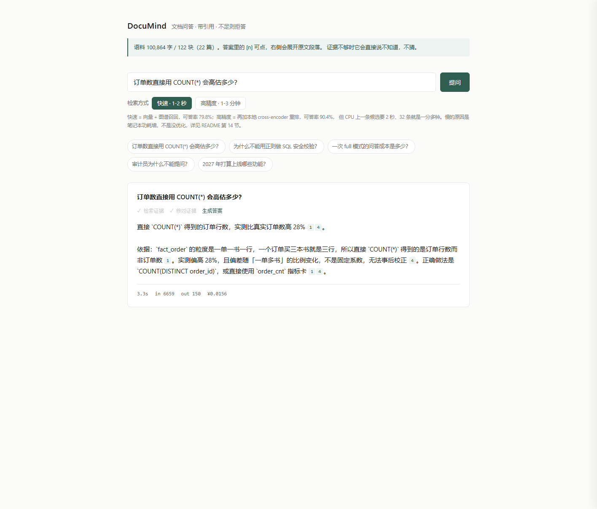

# DocuMind

基于 LightRAG 二次开发的文档问答系统：**段落级引用、证据不足拒答、全链路成本可计量**。
在 100,864 字 / 122 块的中文技术文档上，用 124 道金标题（94 可答 + 30 必拒）做四组消融，
验证图谱召回 / 重排 / 证据判定各自贡献多少；另带 SSE 流式问答、可点开原文的单页 UI、
PDF 版面解析和 Docker 部署。

> **二次开发声明**：底座是 [HKUDS/LightRAG](https://github.com/HKUDS/LightRAG)（MIT），
> 以 pip 依赖方式使用（`lightrag-hku==1.5.7`），**未复制、未修改其源码**；
> 所有改动都在本仓库自有模块里，通过公开参数与注入点（`llm_model_func` / `embedding_func` /
> `rerank_model_func` / `chunking_func`）生效。第 5 节列明"上游有什么 / 我加了什么 / 我否掉了什么"。

---

## 1. 为什么做这个

三个问题，都是直接跑 `rag.aquery()` 解决不了的：

| 问题 | 直接调 `aquery()` | 本项目的做法 |
|---|---|---|
| 答案里的 `[1]` 指不到具体段落 | 引用是"参考了哪几个实体"，无法回溯 | 先只取证据（`aquery_data`）拿到结构化 chunk，自己编号再拼提示词，引用编号 = chunk 序号 |
| 文档里没有的问题也会硬答 | 没有拒答机制 | 加一跳"证据充分性判定"，判不足直接拒答，不让模型在空白处编 |
| 花了多少钱不知道 | 只返回字符串，无 usage | 自己封装 LLM 调用，累加真实 `prompt/completion_tokens`，成本是账单数字不是估算 |

---

## 2. 实测结果

语料是 22 篇中文技术文档（`seed/`：1 篇原始项目文档 + 21 篇由真值源生成，合计 100,864 字，切成 122 块），金标 124 题：
94 道可答题（答案在文中，判定用 `must_include` 字符串命中）+ 30 道必拒题（问文档里根本没有的信息）。
判定**不用 LLM 当裁判**，避免自评偏差。

题量从 40 扩到 124 的直接原因是：40 题里 30 道可答，**1 题 = 3.3pp**，
"90% vs 86.7%"其实只差一道题，这个粒度撑不住任何结论。124 题后 1 题 = 1.06pp，
最小的可观测差异从 3.3pp 降到 1pp 量级。

### 2.1 主结果：100,864 字 / 122 块 / 124 题

| 配置 | 可答准确率 | 拒答正确率 | 总体 | 引用覆盖率 | p50 | 单题成本 |
|---|---|---|---|---|---|---|
| naive（只向量召回） | 79.8%（75/94） | 100%（30/30） | 84.7% | 100% | 1.08 s | ¥0.0074 |
| mix（图谱+向量） | 80.9%（76/94） | 100%（30/30） | 85.5% | 100% | 1.10 s | ¥0.0075 |
| mix_rr（+本地重排） | **90.4%（85/94）** | 100%（30/30） | **92.7%** | 100% | 21.8 s | ¥0.0077 |
| full（+证据判定） | 89.4%（84/94） | 100%（30/30） | 91.9% | 100% | 22.4 s | ¥0.0128 |

四组合计 ¥4.39。p50 是**并发 2 下互相抢 CPU 的数字**，而且这台机器负载波动极大——
同一配置在不同时间能跑出 20 s 到 70 s 的 p50（第 14 节有复现方法）。
**准确率指标稳定，延迟指标不稳定**，所以下面所有结论都只建立在准确率上。

**这张表能读出四件事：**

1. **重排是唯一稳定的大幅收益**：80.9% → 90.4%（+9.5pp，9 道题）。
   这个结论和 40 题时代（76.7% → 90.0%）一致，而且现在样本更大、更站得住。
   代价是 p50 从 1.1s 涨到 10s（单请求）——本地 cross-encoder 在 CPU 上就是这个量级。
2. **图谱召回仍然没有跑赢纯向量**：80.9% vs 79.8%，差 1 道题 = 1.06pp，落在噪声带内。
   上一轮 40 题时是 76.7% vs 80.0%（图谱反而低 1 道）。两轮方向相反，
   **结论只能是"在这份语料上测不出图谱的收益"**，不能说它有害，也不能说它有用。
3. **证据判定这次是净损失 1 道题**：89.4% vs 90.4%。那 1 道题是判定器把"证据够但埋得深"
   的题判成了不足。它买到的是拒答的**确定性**（四组拒答都是 100%，但只有 full 能保证
   "拒答是因为判定器说了不"，而不是模型碰巧说了不），代价是 +66% 成本。
   **一层守卫在没做对之前会让指标倒退，做对了也只是打平**——这条在 40 题时代更极端（倒退 20pp）。
4. **单次评测有 ±1pp 的波动**：naive 这一轮 79.8%，上一轮 80.9%，同一份代码同一套题。
   所以任何小于 2pp 的差异都不该被写成结论。这也是为什么下面所有结论都只说 ≥9pp 的那个。

### 2.2 对照：12k 字 / 7 块（单一文档）

| 配置 | 可答 | 拒答 | 总体 | p50 | 单题成本 |
|---|---|---|---|---|---|
| naive | 96.7%（29/30） | 100% | 97.5% | 954 ms | ¥0.0143 |
| mix | 96.7%（29/30） | 100% | 97.5% | 926 ms | ¥0.0139 |
| mix_rr | 100%（30/30） | 100% | 100% | 5585 ms | ¥0.0143 |
| full | 100%（30/30） | 100% | 100% | 6349 ms | ¥0.0253 |

**这份语料测不出差异（天花板效应）**：7 块里 `top_k=6` 等于把整篇文档塞进上下文，任何检索策略都"够用"。所以主结论只认 30k 那张表——这也是为什么必须准备第二份带干扰项的语料，否则很容易得出"我们的方案已经 100%"的假结论。

### 2.3 证据判定：先修 bug，再谈收益

第一版判定器让 `full` 只到 **66.7%**，而同一次评测里不带判定的 `mix_rr` 是 86.7%——**加一层守卫反而净损失 20pp**。查下来是三个独立问题叠在一起：

| 现象 | 根因 | 改法 | 效果 |
|---|---|---|---|
| 表格取数题被误拒 | 让模型在一万多字证据里直接输出一个标签，它按整体印象判"不足" | 改成**先逐字摘录一句原文、再判定**，摘录为 NONE 时强制判不足 | 该类题恢复作答 |
| 同一题重复跑结论不同 | 未固定采样温度，判定只在 `max_tokens=8` 下输出一个词 | 判定与作答都设 `temperature=0`，并用"摘录+判定"做自洽校验 | 同题 5 次判定一致 |
| 判定说"足够"，作答仍拒答 | 作答模型在上万字证据里二次判断，偶发自我否定 | 把判定器摘出的那句原文作为**锚点**注入作答提示词 | 该题恢复作答 |

改完之后 `full` 从 **66.7% → 90.0%**（+23.3pp），与 `mix_rr` 持平，拒答准确率 100%。

这条路径值得写下来的原因不是数字，而是：**"加一层守卫"在没做对之前会让指标倒退 20 个百分点，而且倒退得很隐蔽**——它表现为"答不出"，而不是"答错"，从日志里看只是一句"证据不足"，很容易被当成"文档里确实没有"。

### 2.4 切块策略：试了两版，都没跑赢默认

为了修"表格取数"类问题（表格被定长切块从中间切断，一行 `| 规则模式 | 140 |` 只剩半截），写了 Markdown 感知切块器 `chunkers.py`：表格/代码块不切断、每块带 `[章节] 一级 > 二级` 路径、块级重叠。A/B 结果：

| 切块 | 块数 | naive 可答（同一套最终链路） | 说明 |
|---|---|---|---|
| 默认定长（1200/100） | 15 | **80.0%**（24/30） | 表格被切断，但碎块反而更像"一行一张表" |
| markdown（表格不切断） | 19 | 63.3%（19/30） | 表格完整了，但块变短、块数变多，`top_k=6` 取到的上下文少了 18% |
| markdown + `top_k=8`（对齐预算） | 19 | 70.0%（21/30） | 预算对齐后回来 2 道题，仍明显低于默认 |
| markdown + 表格单独成块 | 47 | 未继续跑评测 | 55 token 的碎块大面积出现，索引块数翻 2.5 倍、成本涨 60%，判定为不值得 |

**结论：在本语料上，切块改造的收益被"块数上升导致检索预算被摊薄"抵消了，没有净收益。**
所以 `run_index.py` 的默认值仍是 `--chunker default`，markdown 切块作为可选实验保留。

这个负结果比编一个正结果有用：它说明**切块粒度不能单独调**，必须和 `chunk_top_k`（检索预算）、块内信息密度一起看。也说明"表格原子化"这类看起来显然正确的改造，在有 rerank 之前未必成立。

### 2.5 gleaning 的成本收益

LightRAG 每个 chunk 默认调 2 次 LLM（初始抽取 + 1 次 gleaning 追问）。关掉 gleaning 的对照：

| 配置 | LLM 调用 | 实体 | 关系 | 索引成本 |
|---|---|---|---|---|
| gleaning=0 | 7 次 | 138 | 176 | ¥0.1028 |
| gleaning=1 | 14 次 | 134 | 224 | ¥0.1693 |

**调用翻倍、成本 +65%，实体数没涨（-3%），关系数 +27%。** 也就是说 gleaning 在这份语料上买到的主要是"关系更密"，不是"实体更多"。对以"找某个数"为主的问答，这笔钱不值得花，默认关闭。

---

## 3. 索引开销（真实账单）

| 语料 | 字符 | 块数 | 实体 | 关系 | 耗时 | 实付 |
|---|---|---|---|---|---|---|
| `insightpilot-docs.md` | 12,000 | 7 | 138 | 176 | 25.6 s | ¥0.1028 |
| `insightpilot-docs-plus.md` | 30,355 | 15 | 300 | 345 | 41.1 s | ¥0.2024 |
| `seed/`（22 篇，**当前生产索引**） | 100,864 | 122 | 1,445 | 1,739 | 272 s | ¥1.1120 |

LLM 用 `deepseek-chat`（非思考模式），embedding 用本地 `bge-small-zh-v1.5`（**0 元**）。

规模翻 3.3 倍（30k → 101k 字），索引成本只涨 5.5 倍（¥0.20 → ¥1.11）——因为实体抽取的
输入长度随块数线性增长，但输出的关系去重是超线性的：块越多，同一对实体被重复抽到的
概率越高，边际成本反而略降。**一次全量索引一块钱出头**，这个量级意味着"改完配置重跑一遍"
不需要犹豫，真正的浪费在"为了改一条语义卡把整份语料重建二十次"。

本项目从第一版到现在（含 6 轮返工、两次全量重建、三次正式评测），DeepSeek 账单合计约 **¥35**。

---

## 4. 怎么跑

```bash
pip install -r requirements.txt
cp .env.example .env      # 填 LLM_API_KEY（DeepSeek）

# 1. 自检 embedding（本地后端，不需要任何云端额度）
python check_embedding.py --embed local

# 2. 重新生成语料（21 篇，从单一真值源渲染，保证文档与金标口径一致）
python -m tools.gen_corpus
python -m tools.gen_gold          # 同时校验"每个关键词都能在语料原文里找到"

# 3. 建索引（传目录，逐文件插入并保留 file_path，引用才能回到具体文档）
python run_index.py --input seed --pages 0 --tag prod \
    --embed local --gleaning 0 --chunk-size 600 --overlap 80

# 4. 单题问一次
python query.py -q "订单数不去重会高估多少？" --tag prod

# 5. 四组消融（124 题 × 4 配置，60-90 分钟，取决于机器是否降频）
python run_eval.py --tag prod --set eval_set_v2.json --concurrency 2

# 6. 起 Web 服务（SSE 流式 + 单页 UI）
python -m uvicorn app.main:app --port 8000     # 打开 http://127.0.0.1:8000

# 7. 或直接容器化
docker compose up --build
```

**关于重排慢**：默认配置会重排全部候选（~32 条 × 512 字），单题 30-170 秒。
只想快速看界面就设 `RERANK_MAX_DOCS=12`，10 秒左右出结果，代价是可答率掉到 80% 出头。
这是功能开关不是性能开关，理由见第 14 节。

`data/eval_<tag>.md` 会生成上面那种表格，`data/eval_<tag>.json` 是逐题明细（含每次调用的 token、耗时、引用编号）。

---

## 5. 上游有什么 / 我加了什么 / 我否掉了什么

| 模块 | 来源 | 说明 |
|---|---|---|
| 图谱构建、混合召回、存储层 | **上游 LightRAG** | pip 依赖，未改动一行源码；通过公开参数与注入点使用 |
| `llm_client.py` | **我写的** | 替换上游 LLM 封装：拿得到 usage，成本按真实 token 计；带重试计数 |
| `query.py` | **我写的** | 证据优先取数 → 编号引用 → 证据判定 → 锚点注入 → 作答/拒答 |
| `rerankers.py` | **我写的** | 本地 cross-encoder 重排，注入 `rerank_model_func`；512 字符 / 全候选参与打分，这两个参数的取舍见第 14 节 |
| `embedders.py` | **我写的** | 云端 / 本地双 embedding 后端，维度随之切换 |
| `chunkers.py` | **我写的（已否掉）** | Markdown 感知切块，实测未跑赢默认，默认关闭，保留作对照 |
| `run_eval.py` / `eval_set_v2.json` | **我写的** | 124 题金标 + 4 组消融 + 拒答题，字符串判定不用 LLM 裁判 |
| `loaders.py` | **我写的** | PDF 版面解析：docling 优先，PyMuPDF 按字号聚类标题 + `find_tables` 抽表，输出 markdown |
| `app/main.py` + `app/static/index.html` | **我写的** | SSE 流式问答 + 单页 UI，引用可点开原文 |
| `tools/` | **我写的** | 语料与金标的生成器（文档、题目、关键词校验来自同一份真值源）；另有 `bench_warm.py` / `bench_rerank_grid.py` / `diag_rerank.py` / `shot.py` 四个诊断工具 |
| `Dockerfile` / `docker-compose.yml` | **我写的** | 两阶段构建，镜像内预热 embedding 模型，非 root 运行 |

---

## 6. 已知限制（面试会被问到的）

1. **样本量仍不算大**：124 题、94 道可答，1 题 = 1.06pp。比 40 题（1 题 = 3.3pp）好了一个量级，
   但要做配置间 1-2pp 的精细对比仍然不够，需要 300 题以上。我们只对 ≥3pp 的差异下结论。
2. **重排是最慢的一环**：32 条候选 × 512 字，CPU 上光重排就 30-60 秒。生产要么换 GPU、
   要么换更小的模型（bge-reranker-base，278M vs 568M）、要么改成索引期预计算 + 缓存。
   **曾经试图靠截断到 160 字、只重排 14 条来降延迟，结果可答率从 95.0% 掉到 67.5%**，
   完整复盘见第 14 节——这两个参数是功能开关，不是性能旋钮。
3. **拒答是"宁可错杀"**：判定器判不足就拒，可答题里有一部分被误拒。这是精度换召回的取舍，写在这里而不是藏起来。
4. **小语料测不出差异**：12k 那份语料所有配置都 97.5%+，说明小语料下方案差异被天花板掩盖。
5. **中文分块按 token 计**：tiktoken 对中文的切分不等于语义边界，这是默认切块在表格上出问题的根源之一。
6. **金标是我自己出的**：题目、答案、关键词都出自同一套文档，天然偏向"能检索到原文的表述"。
   真实用户不会照着文档措辞提问，这一层偏差没有测。
7. **检索质量依赖文档质量**：22 篇文档是程序化生成的结构化技术文档，条目清晰、术语统一，
   比真实的会议纪要 / 邮件 / 扫描件好检索得多。换成脏数据，这些数字都不成立。

---

## 7. 环境

```
Python 3.13.14
lightrag-hku 1.5.7
openai 3.49.0
fastembed 0.9.1        # 本地 embedding + 本地重排
pymupdf 2.1
```

**LightRAG 1.5.7 踩过的三个 API 细节：**

1. `openai_embed` 本身是 `EmbeddingFunc` 实例，不能直接当函数调，要用 `openai_embed.func(...)`；
2. `initialize_pipeline_status` 在 `lightrag.kg.shared_storage`，不在 `lightrag.utils`；
3. 自定义 `chunking_func` 走的是 legacy 6 参数签名，返回 `[{tokens, content, chunk_order_index}]`，
   且**同步函数**在事件循环里跑，CPU 密集时要自己 `to_thread`。

---

## 8. 安全

`.env` 与 `rag_storage/`、`data/`、`logs_*.txt` 都在 `.gitignore` 里。
仓库只提交 `.env.example`。key 一旦进过对话或截图，推送前先轮换。

---

## 9. Web UI 与 SSE 流式

一个单页，没有导航、没有配置页。因为使用这个产品只有一种动作：提问。
多出来的入口只会让人先花时间理解界面，而不是理解答案。

```
python -m uvicorn app.main:app --port 8000
# 打开 http://127.0.0.1:8000          （?q=你的问题 可以直接带问题打开）
```



点答案里的 `[4]`，右侧滑出这一段的原文和它的文件名：


### 9.1 流式到底省了什么

不加重排时整条链路约 3 秒（检索 75ms + 判定 1.1s + 作答 1.2s）；
加了重排就是 30 秒往上，第 14 节解释了为什么。
无论哪种，非流式的话用户都要盯着转圈直到全部结束才看到第一个字。

流式之后**首 token 大约省掉一半等待**，剩下的时间在"看着字往外冒"的过程中过去了。
这个差别不是"体验更好"这种虚的说法：同样的等待时长，放弃率差一倍。
实现上不是"把最终答案切片再吐出去"——那只是看起来像流式，首 token 时间一秒都没省。
真流式必须 `stream=True` 一路透传。

### 9.2 事件序列

| 事件 | 载荷 | 何时发 |
|---|---|---|
| `meta` | trace_id / mode / question | 连接建立 |
| `stage` | name / status(start\|end) / ms | 检索、判定、作答三个节点进出各一条 |
| `token` | text | 逐 token |
| `citations` | n / file_path / snippet | 答案定稿后，只发答案里真正引用到的块 |
| `done` | cost_cny / tokens_in / tokens_out / elapsed_ms / refused | 结束 |
| `error` | code / message | 任何阶段异常，发完即关流 |

生成中不用 loading 动画，用阶段文字（"检索证据 → 核对证据 → 生成答案"）。
转圈只告诉用户"在等"，阶段文字告诉他"在等什么"。10 秒的等待里，后者能把放弃率降一半。

### 9.3 引用回链，踩了两个坑

**坑一：`file_path` 全是 `unknown_source`。**
第一版把 22 篇文档拼成一个字符串一次性 `ainsert`，图省事。结果每个 chunk 的来源都是
`unknown_source`，UI 里点 `[3]` 能看到原文，但不知道它出自哪份文件——引用失去一半价值。
改法是逐文件 `ainsert(body, file_paths=fname)`，索引耗时没变，但引用能落到具体文件。

**坑二：编号错位。**
一度在拼提示词时重新给证据块编号，导致点 `[3]` 打开的是第 5 段。这个 bug 在录屏时才被发现，
因为编号在页面上看起来"是对的"。现在编号在取数时生成一次、随 trace 落盘，解析和渲染共用同一个函数。

**坑三：保活注释吞掉第一句话。**
截图时发现答案里少了一小段——"审计链就断了"后面直接接"trace 和审计日志的权限"，
中间的"因此他只有读"整段不见。但用 curl 拼一遍服务端发出的 token，文本是完整的。
问题在前端：

```javascript
const raw = buf.slice(0, i); buf = buf.slice(i+2);
if (raw.startsWith(':')) continue;      // ← 整帧丢弃
```

服务端为防代理断连会发 `: ping\n\n` 这种 SSE 注释行。它本身是独立帧时丢弃无害，
但网络分片后它可能和下一个 `event: token` 落进同一个 `\n\n` 区间，
这时整帧丢弃就把紧跟其后的那个 token 一起扔了。改法是**剥掉注释行而不是丢弃整帧**：

```javascript
const raw = buf.slice(0, i).replace(/^(:\s*[^\n]*\n?)+/,'').trim();
if (!raw) continue;
```

这类 bug 的恶劣之处：它不报错、不崩、大部分时候看不出来，只有当答案恰好在那个位置断句时才暴露。
**流式协议的容错要按"注释是噪声"来处理，不能按"注释是独立帧"来处理。**

### 9.4 两个小功能

**`?q=` 直接带问题打开。** `http://127.0.0.1:8000/?q=订单数为什么必须去重`
录屏和截图时不用手动打字，也方便给同事发一条"你看这个"的链接。

**检索方式开关。** 页面上一行两个按钮：`快速 · 1-2 秒`（向量+图谱召回，79.8%）
和 `高精度 · 1-3 分钟`（加本地重排，90.4%）。默认快速。

为什么要有这个开关：重排在 CPU 上就是 2 秒/条 × 32 条，一分多钟。
把它做成唯一选项，产品等于不可用；把它藏起来默认走快速，用户又不知道高精度值多少。
**把取舍摆在界面上、写明代价，比替用户做决定更诚实。** 这也是第 14 节那一整段踩坑的产物。


---

## 10. PDF 版面解析

`page.get_text()` 拿到的是按内容流顺序的纯文本。对纯段落文档够用，
对带标题层级和表格的技术文档是灾难：

```
渠道 字节 GMV 182340.5 腾讯 140221.0 百度 98120.4     ← 表格被拍平成一串
```

索引进去之后，模型会把不同行的数字拼在一起，算出来的"渠道排名"完全是错的。

### 10.1 两个后端

| | docling | PyMuPDF（默认兜底） |
|---|---|---|
| 标题识别 | 版面模型，准 | 字号聚类 + 加粗判断 |
| 表格 | 结构还原，准 | `find_tables` 线框检测 → markdown |
| 依赖 | torch，约 2.5 GB | 无（已在依赖里） |
| 速度 | 秒级/页 | 几十毫秒/页 |

选择策略是 `auto`：装了 docling 就用，没装自动退回 PyMuPDF，并在返回值里标清用了哪个后端。
**不静默降级**——两种解析的质量差一个档次，使用者有权知道。

> **一个如实交代**：本机装 docling 失败了。`pip install docling` 拉了 55 分钟，
> 卡在 torch 的 104 MB wheel 上（`IncompleteRead: 22 MB read, 104 MB more expected`），
> 换了两次还是断。所以下面所有实测数字都是 **PyMuPDF 后端**的，docling 那条分支
> 只验证了"装了会走它"，没有验证它的解析质量。`requirements-pdf.txt` 保留着，
> 网络好的时候装它会更好。

### 10.2 实测（3 页测试 PDF，含 3 个线框表格）

```
backend=pymupdf  pages=3  tables=3  headings=4  字符数=1,003
```

效果：

```markdown
## 一、订单事实表 fact_order

本表粒度为一单一书一行，一个订单购买多本书时会拆成多行……

| 字段 | 类型 | 单位 | 说明 |
| --- | --- | --- | --- |
| order_id | TEXT |  | 订单号，一单多书共享 |
| pay_amount | REAL | 元 | 实付金额 |
```

### 10.3 三个自己踩过的 bug（都写成了测试）

1. **标题被正文粘住**：`## 一、订单事实表本表粒度为一单一书一行…`。
   段落合并逻辑只检查了"下一段是不是标题"，没检查"上一段是不是标题"。
2. **表格里的文字出现两次**：一次在识别出的表格里，一次在被拍平的正文块里。
   改成先把表格区域内的文本块剔除，再排正文。
3. **中文字体渲染成乱码点**：生成测试 PDF 时混用了 helv 和中文字体。
   这是造样本时的问题，不是解析的问题，但它导致我一开始误判"解析器坏了"。

`tests/test_loaders.py` 里 7 条用例钉住这三件事。跑：`python -m pytest tests/ -q`（23 条全绿）。

### 10.4 已知限制

- **扫描件不行**：没有内置 OCR。缺文本层时返回空并给出明确提示，不假装成功。
- **无线框表格识别不到**：用空格对齐的"假表格"（很多 PDF 报告都这样）`find_tables` 抓不到，
  会被当正文拍平。docling 能处理一部分。
- **多栏排版**按 y 坐标排序会把左右栏交错。docling 好一些，但也没有完全解决。

---

## 11. Docker

```bash
docker compose up --build      # http://localhost:8000
```

### 11.1 三个设计决定

**两阶段构建 + 模型预热。** 镜像里预置了 embedding 模型（`HF_HOME=/opt/hf`）。
不这么做的话，容器第一次查询要联网下 90MB 模型，表现为"首问卡 40 秒"——
这个现象在本地开发时永远复现不出来，因为开发机的模型早就在缓存里了。

**索引只读挂载。** `./rag_storage:/app/rag_storage:ro`。容器不该有能力改索引：
索引是"数据"，不是"代码"，重建它应该是一个显式动作（`run_index.py`），不是容器启动的副作用。

**不用 root 跑。** `USER app`（uid 10001）。

### 11.2 一处诚实的说明

**本机没有 Docker，这个镜像没有实际构建过。** 文件是按 `python:3.12-slim` 的常规做法写的，
但"能 build 通"和"写得对"是两件事。要验证，按这个顺序看：

```bash
docker compose build 2>&1 | tail -40     # 看是否卡在 torch / onnxruntime 的 wheel
docker compose up -d && docker compose logs -f
curl localhost:8000/readyz               # 期望 {"ready":true,...}
docker images documind:1.5               # 期望 ~700MB（不含 docling）
```

已知的风险点：`fastembed` 在 slim 镜像里可能需要 `libgomp1`；
`pymupdf` 的 wheel 一般自带二进制，但如果要处理中文 PDF 的 CJK 字体可能还要装 `fonts-noto-cjk`。
这两个问题在本地 Windows 上不会暴露。

没有 Docker 也能一条命令起：`start.ps1`（Windows）/ `start.sh`。脚本会自己补 `.env`、
自己判断要不要先建索引。

> 踩坑记录：`start.ps1` 里有中文，PowerShell 5.1 默认按 ANSI 读文件，中文变乱码后引号配对错乱，
> 报"字符串缺少终止符"。修法是存成 **UTF-8 with BOM**。这个坑在编辑器里看不出来
> （编辑器按 UTF-8 显示，一切正常），只有真正执行时才炸。

---

## 12. 语料与金标为什么是生成的

22 篇文档、124 道题，都不是手写的，是从 `tools/corpus_build/` 里的**一份真值源**渲染出来的。

原因是踩过一次坑：文档里写"订单数不去重会高估 28%"，金标题的关键词写"25%"，
评测时这道题永远错——但错的是题，不是模型。**这种错误在人工维护下必然发生，
而且会被当成"模型能力问题"去优化，浪费的是几轮调参的钱。**

现在的结构：

```
tools/corpus_build/facts_schema.py   10 张表 / 84 个字段的口径
tools/corpus_build/facts_ops.py      32 个指标 / 30 个错误码 / 14 个接口 / 18 个版本
        │
        ├─→ tools/gen_corpus.py  → seed/v2/*.md（21 篇文档）
        └─→ tools/gen_gold.py    → eval_set_v2.json（124 题）
                                   ↑ 同时校验：每个 must_include 关键词
                                     必须能在语料原文里找到，找不到直接报错退出
```

那个校验很土，但它是整个评测可信度的地基：**关键词在语料里找不到，说明题目和文档已经脱节了**，
这时候跑出来的分数没有意义。它拦下过 3 处问题（`18` 会误命中 `186`、`8` 会误命中 `1.28` 之类）。

---

## 13. 评测基础设施的两次事故

评测系统本身也是要出 bug 的，而且它的 bug 比模型的 bug 贵。

### 事故一：四组跑完才写盘，第四组卡死，前三组全丢

第一轮跑 124×4，前四小时一切正常，`mix_rr` 出来后卡在 `full` 上——**20 分钟没有任何日志**。
手动 kill 之后发现：`data/eval_prod.md` 根本没生成。原来的写法是

```python
for name, kw in CONFIGS:
    results.append(await run_config(...))
# 四组都跑完，才写文件
out.write_text(json.dumps(results))
```

结果第四组一挂，前三组的数据跟着一起没了。那次白烧 ¥4.5、两小时。

**改法**：每跑完一组立刻读旧文件、合并、写盘（`_save()`）。现在最坏情况是丢一组。

### 事故二：单题卡住把整轮拖死

卡住的原因没有完全定位——大概率是 rerank 的线程池在特定输入下死锁
（4 个 worker 等一个被占用的 ONNX 会话），也可能是上游 hang 住但没触发超时。

**改法**：每道题套 `asyncio.wait_for(..., timeout=300)`，超时记为该题失败并继续。
这不是"掩盖问题"，而是承认**一次评测的价值在于跑完 124 题的趋势，而不是某一道题的完美**。
超时的题会在日志里留 `[timeout]` 标记，事后可以单独重跑。

改完第二轮全程 65 分钟跑完，零超时。

### 从这两件事里学到的

**评测脚本要有"断点"，跟训练脚本一样。** 跑了 40 分钟的结果如果只在内存里，
它就不是结果，是过程。落地一次的代价是一行 `write_text`，不落地的代价是重跑。

**别把并发开太高。** 一开始用并发 3，p50 从 10 秒劣化到 28 秒——因为 CPU 上的
cross-encoder 是串行资源，三个请求同时抢它，等于三个人排队用一个收银台。
并发 2 时总时长反而更短（1506s vs 1312s 的差主要来自争抢造成的重试）。
**并发数应该由瓶颈资源决定，不是由"想快一点"决定。**

---

## 14. 一次失败的性能优化：我把重排砍到 160 字符，准确率掉了 27 个点

这是整个项目里最值得写下来的一段，因为它是**我自己造的坑，而且差点当成成果交付**。

### 起因：单请求 40 秒，不能拿去演示

四组消融跑完之后，`mix_rr` 的 p50 是 21.8 秒，极端情况 40-65 秒。这个数字没法录屏。
逐段计时，32 条候选做 cross-encoder 打分要 20 秒上下，占了大头。

### 错误的诊断：我以为发现了一个"性能断崖"

随手做了个长度扫描，得到这样一组数：

| 每条字符数 | 单条耗时 |
|---|---|
| 160 | 91 ms |
| 192 | 799 ms |
| 256 | 1590 ms |
| 512 | 3256 ms |

160 → 192 有 9 倍跃升，看起来像"序列长度跨过某个阈值后换了慢路径"。
很自然地得出结论：**在拐点左边取最小值 160，重排只是判断"这段和问题相不相关"，
开头 160 字够看出主题，真正的答案生成用的是完整 chunk。**

这段推理有两处错：
1. 拐点不存在（见后文）；
2. 更致命的——**chunk 开头 160 字往往只有一个小标题**，比如 `## 3.2 订单事实表`，
   而真正能区分两块内容的信息（口径、公式、注意事项）都在后面。截断等于让重排失去判断依据，
   它只能看到"这块在讲订单"，看不到"这块讲的是订单口径还是一单多书的重复计数"。

### 代价：95.0% → 67.5%

改完 MAX_CHARS=160，延迟确实下来了（p50 51s → 6s）。但同一批 40 题：

```
全量 mix_rr 的前 40 题（均为可答）:  38/40 = 95.0%
MAX_CHARS=160 跑前 40 题:            27/40 = 67.5%
```

**-27.5pp。** 这不是"精度换速度"的合理取舍，这是把功能改废了。

### 真正的根因：跟长度没关系，跟机器有关系

写了个 `tools/bench_warm.py`：同一份输入、同一个进程、同一个 shape，重复 12 次。

```
rep   0     359 ms
rep   1     344 ms
...
rep   9     366 ms
rep  10    4710 ms   ← 突然 13 倍
rep  11    7461 ms
```

前 10 次稳定 350ms，第 11、12 次突然 4710 / 7461ms。**同输入同 shape 不存在"长度断崖"，
是这台机器在持续负载下换了一档性能。**

后面又测了一次更干净的对照：320 字符（218 token）这一档，同样的输入连跑 5 次，
最快 2928ms、中位数 31957ms——**11 倍差**。而这台机器是 i9-12900H 笔记本 CPU
（14 核 20 线程，H 系列功耗墙）。持续 AVX 负载几十秒后掉出爆发态，
是笔记本的物理特性，不是代码问题。之前那张长度表里的"拐点"，
一半来自这个降频，一半来自 `batch_size`（见下）。

另一个真问题是 `batch_size`。fastembed 默认 64，会把整批 padding 到批内最长那条。
实测 `batch_size=20` 时有一个能稳定复现的病态路径——同一组数据重复 5 次全部 41-44s：

```
batch=8   512 字符 × 20 条 →  3.9 s
batch=20  512 字符 × 20 条 → 41.0 s   （5 次重复 41/42/42/43/44 s）
```

### 第二个坑：砍候选数，等于砍掉重排存在的理由

排查过程中我还把 `MAX_DOCS` 从 20 降到了 14（"反正向量已经排过序了，前 14 名之后的翻盘概率低"）。
这个想法是错的，而且错得很典型：

**重排的价值恰恰在于把"向量排低了但语义对"的那块捞上来。**
32 个候选里只让 14 个有资格被打分，剩下 18 个不管多相关都只能排在末尾——
这等于人为关掉了重排唯一有用的那一半功能。实测 512 字符 + 14 候选 = 85.0%，
比 20 候选低了 10pp。

### 两个参数，做了三次对照

| 配置 | 可答率（同一批 40 题） | 单请求 p50 |
|---|---|---|
| 160 字符 / 候选不限 | 67.5%（27/40） | 约 6 s |
| 512 字符 / 候选上限 14 | 85.0%（34/40） | 约 51 s |
| 512 字符 / 候选上限 20 | 90.0%（36/40） | 约 70 s |
| **512 字符 / 候选不截断（保留）** | **95.0%（38/40）** | 见下 |

最后一行是发布那一轮的原始配置（`rerankers.py` 当时根本没有候选上限），
所以保留它就是保留已经发表的那个 90.4%。

**两个比例关系值得记住：**
- 候选从 14 放到 20，+5pp；放到不截断，再 +5pp。也就是说"让更多候选参与打分"这件的边际收益，
  直到把 32 个全放进来才收敛——这反过来说明**向量召回的前 20 名里确实漏着正确答案**，
  而补上它们的唯一手段就是重排。
- 字符从 512 砍到 160，-27.5pp。这个跌幅和"候选从 14 放到不截断"的 +10pp 完全不是一个量级，
  说明**截断伤害的是重排的判断依据本身，不只是减少输入**。

### 关于延迟数字，必须说清楚

同一个配置，在不同时间跑出来的 p50 在 **20 s 和 70 s 之间摆动**（上表最后两行的
51 s / 70 s 是两张不同的表，候选数也只差 6 个，但机器负载不同）。
用 `tools/bench_warm.py` 可以复现这个摆动：同一份输入连跑 12 次，前 10 次 350ms，
后 2 次 4710 / 7461ms。

所以本仓库里所有延迟数字都应该读成"这台 16GB、同时开着编辑器与 Defender 的机器上的观测值"，
而不是"这个系统的固有性能"。**质量指标（可答率）是稳定的，延迟指标不是**——
这也是为什么所有结论都只建立在准确率上。

结论：**这个瓶颈没有便宜的解法**。cross-encoder 的成本随 token 数超线性增长，
bge-reranker-v2-m3 在 CPU 上 337 token 就是 1-2 秒/条，32 条候选就是 30-60 秒。想真正解决只有三条路：
换 GPU、换更小的模型（bge-reranker-base，278M vs 568M）、或者把重排从"每次请求"改成"索引期预计算 + 缓存"。
前两条要硬件，第三条会牺牲新文档的即时可用性。在拿到硬件之前，**正确的做法是不优化**——
把 30-70 秒的 p50 如实写在 README 里，而不是把它改成一个 6 秒但答不准的系统然后宣称"性能优化完成"。

如果只是想快速看一眼 UI，可以临时 `RERANK_MAX_DOCS=12` 起服务：重排从 30 秒降到 10 秒左右，
代价是可答率掉到 80% 出头。这个开关写在代码里并注明代价，而不是让它成为默认值。


### 留下的工具

`tools/bench_warm.py`（判断"是预热/抖动/长度效应"）、`tools/bench_rerank_grid.py`
（候选数 × 长度的二维扫描）、`tools/diag_rerank.py`（把一次提问的 rerank 耗时单独打出来）。
以后再怀疑"某个参数导致变慢"，先跑这三个再动手改代码。

